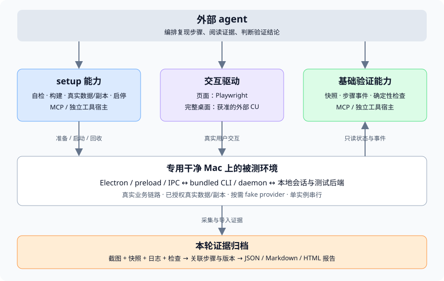

# 面向 agent 的自动化验证能力实施方案

本文给出首版的范围、模块、工具协议、数据准备、诊断与证据契约，以及实施和验收顺序。七个模块的首版代码已落地，实际可用范围、工具 schema、使用方法和验收边界见[验证包说明](../../packages/verification/README.md)。本文保留架构目标及设计示例，不能将所有示意字段当成当前工具参数；运行时 schema 是调用依据。专用干净 Mac 的完整 Electron GUI 验收尚未执行。

七个模块逐项确认后的底层接口、公共结果、对象身份、调用顺序与实施切片见[接口与实施契约 v1](verification-foundation-contracts.md)。本文负责总体范围，该契约细化模块交互；文档描述架构与语义目标，实际调用参数以运行时 schema 为准。

设计分析基线为 `origin/main` 的 `be88001167e7316d5516105547747846721b82e8`，源码证据表保留该基线；实现分支 `codex/verification-tooling` 已对齐 `origin/main` 的 `5f8d2ccf5` 并复核接入。已有问题评估见 [Bug 验证基础能力评估](bug-verification-foundation.md)。

## 1. 已确认的范围

### 1.1 首版部署与使用前提

- 给到一台专用、干净的 Mac，原生运行 macOS Electron 与其配套 CLI/daemon。
- 提供两个能力域：setup 环境准备，以及基础验证/调试取证，供 agent 按需调用。
- 数据优先使用用户当前真实数据。只读验证可绑定已授权的真实来源；涉及修改或可重复对照时推荐冻结真实数据副本，人工模板仅补充特殊边界。使用真实数据不自动授权发送消息、删除、修改权限或真实模型调用。
- 页面观察和操作使用 Playwright；完整应用的系统级交互复用已经获得相应授权的外部 Computer Use。
- 控制 agent 和验证工具宿主独立于被测 Electron/daemon，关闭被测程序不能导致控制端一起退出。
- 新增验证诊断入口只在 dev 构建中按需启用；生产发行包不包含其入口实现，运行时环境变量不能重新开启。既有业务 API 和正常诊断日志维持原有职责。
- 首版单应用实例、串行验证；基线与修复版本依次启动。不同版本分别准备相同语义的初始数据。
- 修复员可提交复现脚本；验证员依据 PR 决定范围、复核复现方式并补充边界场景。也支持 agent 直接逐步探索，不要求先写完整脚本。
- 有界面现象必须有截图，验证员实际打开检查；无界面问题用日志和测试输出。
- 用户只阅读报告，不承担补做应用交互的验收步骤。
- 新增脚手架、场景及其自动检查不接入 CI；相关测试由开发者手动执行，现有 CI 不扩大到新验证能力。
- 默认 fake provider，不发现或执行用户安装的真实模型 CLI。真实 provider 验证单独授权。

### 1.2 暂缓事项

Docker 化被测客户端、macOS VM、多实例共存与生产全局路径改造、跨设备派发、跨平台适配、第三方插件、云端证据数据库、通用工作流编排，均不作为首版前置。

既有开发环境需要 PostgreSQL 时，继续遵守仓库共享 PostgreSQL、每 checkout 独立数据库的模型。使用 Docker 运行开发数据库属于已有环境依赖，不代表首版将 Electron 放入 Docker。

“干净 Mac”仍需完成依赖安装、系统授权和数据来源/登录初始化。首版不承诺无人值守完成 macOS 密码、辅助功能或录屏授权，也不修改现有 Computer Use 的自操作限制。

## 2. 架构与职责



### 2.1 对外入口

优先提供独立 stdio MCP 服务，运行在专用 Mac 上。外部 agent 配置一次入口后按需调用工具；CLI 作为 setup 引导、人工诊断和同一能力的辅助入口。

已确认采用“底层统一能力接口 + MCP 接入适配层”。底层接口可被代码直接调用，不依赖 MCP SDK、工具名称或协议消息；MCP 将 agent 的工具请求映射为底层调用，并将结果编码为协议响应。

| 层次 | 职责 |
| --- | --- |
| 统一能力接口 | 维护环境、任务、观察步骤、Playwright 对象与证据索引；执行前提与权限检查、幂等控制、生命周期和实际验证逻辑；返回统一结果与错误 |
| MCP 适配层 | 工具发现与注册、协议参数解析、传递已鉴权调用上下文、调用底层接口、转换文本/图片等响应；不自行维护第二套业务状态或判断验证结论 |
| CLI / 脚本入口 | 按需调用同一底层接口，复用其约束与结果，不另写一套执行逻辑 |

MCP 服务保持长连接，底层能力宿主独立于被测应用运行。统一接口不要求新增网络服务，首版可在同一工具进程内直接调用。首版不增加公网 HTTP 服务，不暴露原始 CDP、主进程任意执行或 daemon token。后续若需要其他客户端，复用统一接口增加受认证传输适配，不重写业务逻辑。底层能力测试无需启动 MCP；协议适配测试单独覆盖工具参数与结果映射。

工具宿主应有自己的运行时发行包，或显式使用已安装的匹配 JS 运行时，避免“需要先有 Node 才能调用安装 Node 的工具”的循环。一次性安装控制工具包是引导前提；setup 随后负责被测项目所需的 Node、pnpm、Go、构建组件和数据库依赖的检查与准备。

### 2.2 两个能力域

| 能力域 | 负责 | 成功的含义 |
| --- | --- | --- |
| setup | 依赖检查、准备目标 checkout/构建、后端与账号绑定、真实数据/模板、启动/重置/停止应用、资源归属 | 指定版本的环境满足声明的验证前提 |
| 基础验证 | 状态快照、分步骤事件、确定性检查、页面驱动、证据导入/读取/导出 | 返回有来源的实际观察或检查结果 |

agent 负责选择复现路径、协调外部 CU、补充边界检查、阅读证据并解释最终结论。工具自动生成结构化事实和报告草稿；不根据一条成功退出码自行宣布 Bug 修复。

### 2.3 被测链路与控制边界

完整模式下启动真实 Electron；Electron 走现有 daemon-manager，使用本构建的 bundled CLI 启动 daemon。工具宿主等待实际就绪并记录其归属，不能再启动一份竞争的 daemon。

页面操作通过 Playwright 获取实际窗口对应的 Page，触发正常 preload、IPC 和 daemon 交互。主进程与 daemon 诊断采用窄、只读、有作用域的接口，外部 CU 负责它能覆盖的真实桌面操作。

外部 CU 与 Playwright 对同一个应用的写操作必须串行。观察步骤说明交互驱动；发生导航、窗口重建或应用重启后，窗口/元素引用失效，agent 重新观察。

## 3. 源码依据、复用和缺口

| 证据 | 已核对的实现 | 复用方式与设计结论 |
| --- | --- | --- |
| E1 | [环境管理](../../scripts/dev-env.sh)和[开发约定](../../CONTRIBUTING.md) | 复用环境创建、服务身份校验、数据库和端口管理；读取 JSON 状态，不只解析终端成功文本 |
| E2 | [Desktop 启动](../../apps/desktop/src/main/index.ts)、[daemon-manager](../../apps/desktop/src/main/daemon-manager.ts)、[CLI 打包](../../apps/desktop/scripts/bundle-cli.mjs) | 保留真实启动链路，固定 CLI 构建身份；daemon 使用实际二进制，禁止 go run 作为持久 daemon |
| E3 | [Desktop 注册](../../apps/desktop/src/main/runtime-instance.ts)、[Go 注册](../../server/internal/runtimeinstance/registry.go)、[CLI 实例选择](../../server/cmd/multica/cmd_instance.go) | 当前注册为本机用户固定实例；首版专用 Mac 单实例，不改成全产品多实例；遇到未知现存实例直接阻塞 |
| E4 | [Local API](../../server/internal/daemon/localhost/v2.go)、[会话服务](../../server/internal/localconversation/service/service.go)、[队列服务](../../server/internal/localconversation/service/queue.go) | 复用会话/队列/运行数据与权限检查；快照和队列并非跨层原子读取，必须保留各来源游标 |
| E5 | [测试 API helper](../../e2e/fixtures.ts)、[登录 helper](../../e2e/helpers.ts)、[fake adapter 测试](../../server/internal/localconversation/service/service_test.go) | 复用数据生成思路与业务接口；部分现有 helper 直连 DB 或兜底选第一个工作区，不直接移植为外部工具 |
| E6 | [Playwright 配置](../../playwright.config.ts)、[浏览器队列场景](../../e2e/local-conversation-queue.spec.ts)、[Electron 模块冒烟](../../apps/desktop/scripts/side-preview-smoke.cjs) | 页面 fixture 与 Electron 模块已有基础；完整应用、fake provider 的工具化接入仍需实现 |
| E7 | [独立 MCP 入口](../../apps/desktop/src/main/developer-logs-mcp.ts)、[工具注册](../../apps/desktop/src/main/developer-logs-mcp-server.ts) | 沿用 stdio、schema 和结构化结果模式；新宿主不依赖被测 UI 正常运行 |
| E8 | [日志导出](../../apps/desktop/src/main/developer-log-export.ts)、[运行日志](../../apps/desktop/src/main/developer-runtime-logs.ts) | 复用脱敏、覆盖范围和限额思想；当前 daemon tail 不按操作步骤过滤，需要新增步骤采集与覆盖标识 |
| E9 | [双版本比较](../../scripts/perf-compare.mjs)、[进程树管理](../../server/internal/daemon/processtree/run.go) | 复用同场景对照、旧报告拒绝和清理约束；跨进程长驻服务不能按短命令结束即清理 |
| E10 | [Computer Use 边界](computer-use.md)、[原生策略](../../apps/desktop/native/computer-use/ComputerUse.swift) | 内置能力禁止控制 Multica，自验证不解除此限制；外部 CU 必须实际具备授权和控制能力 |
| E11 | [Codex MCP 注册](../../apps/desktop/src/main/codex-mcp-registration.ts)、[运行配置加载](../../apps/desktop/src/main/runtime-config-loader.ts) | 被测 Desktop 会发生全局 provider 配置副作用，发行配置还可能默认指向云端；需验证启动策略防止真实 provider 发现和错误 API 目标 |
| E12 | [任务评论和附件](../../server/cmd/multica/cmd_issue.go) | 报告交付复用已有评论附件；本地导出与外部发布分开 |

由 E1/E2/E3 得出首版生命周期路径：setup 管理后端及构建 → 启动 Electron → 正常登录并启动 daemon → 核对归属与版本 → agent 操作与取证 → 按归属停止。由 E4/E8 得出诊断路径：真实源数据 → 有覆盖说明的快照/事件 → 明确条件检查 → 归档。尚未有证据证明新工具已经可用。

## 4. 模块与数据模型

### 4.1 代码组织提案

| 位置 | 内容 |
| --- | --- |
| `packages/verification/src/mcp/` | 对外工具 schema、stdio 入口、结果编码和作用域校验 |
| `packages/verification/src/setup/` | doctor、构建/服务准备、生命周期、测试启动策略 |
| `packages/verification/src/data/` | 真实数据绑定/快照与导入、补充工厂、对象引用表、fake provider 控制、重置 |
| `packages/verification/src/sources/` | daemon、renderer、main、backend 与外部证据适配 |
| `packages/verification/src/checks/` | 有限条件、等待语义、来源完整性校验 |
| `packages/verification/src/evidence/` | manifest、文件复制/校验、读取、报告导出和保留策略 |
| `packages/verification/src/page/` | Playwright 窗口与页面操作，不实现原生键鼠栈 |
| `verification/project/` | Multica 构建、服务和健康检查描述 |
| `verification/scenarios/` | 原始复现、检查计划、fixture 引用和可重放脚本 |
| `scripts/verification/` | 首次引导、开发入口与发行准备 |

以上目录已落地，实际接口及范围见验证包说明；不表示要拆成多个服务。新增包直接声明 MCP SDK、Playwright、schema 等依赖，优先沿用仓库 catalog，不引入新的测试框架。公共 schema 放在 `src/contracts/`，宿主、收据与任务支撑放在 `src/host/`，不增加业务模块。通用工具逻辑留在验证包；Desktop/Go 只补最小必需的测试启动和诊断接点，不将业务状态复制进验证包或 UI store。

### 4.2 核心对象

| 对象 | 内容 | 身份约束 |
| --- | --- | --- |
| Environment | 目标 repo/commit、模式、组件、已授权账号/数据来源引用、资源账本 | `environmentId`，创建后目标版本不可变 |
| Verification | 一次验证目标、基线/候选、范围与报告 | `verificationId`，可关联两套串行环境 |
| Dataset binding / fixture | 真实来源与选择范围、快照版本/摘要，或模板及参数；目标对象映射与清理记录 | `datasetId` / `fixtureId`，绑定环境及来源权限 |
| Step | agent 描述的动作与预期、驱动、起止游标 | `stepId`，绑定验证及实际应用 generation |
| Snapshot | 各源实际数据、版本、采集区间、可用性 | `snapshotId`，不承诺跨进程原子性 |
| Check result | 条件、实际/期望、时间语义、状态与证据 | `checkId`，不能由调用者指定通过 |
| Evidence | 文件、来源、步骤、版本、摘要、覆盖范围 | `evidenceId`，发布后不可静默覆盖 |

操作 agent 的会话 ID、本地业务 conversation ID、验证 ID 与 daemon run ID 分开，避免混用。账号与工作区从 setup 绑定的已鉴权环境确定，agent 不能通过自行填写 ID 获得额外访问范围。

### 4.3 页面驱动与应用会话管理

已确认页面模块采用根本方案：统一页面驱动与应用会话管理，操作真实被测实例。底层提供 listWindows、observePage、performAction、captureScreenshot；MCP 映射为相应工具。Setup 持有应用生命周期与资源归属，页面驱动持有同一应用会话的窗口、frame 与元素引用；需要 Playwright 驱动时由 Setup 通过对应启动路径取得连接，不由页面模块另启应用。主进程/daemon 诊断仍由各来源适配器分别采集。

窗口引用绑定 environmentId 和实际应用运行身份，元素引用还绑定窗口/frame 与观察版本。优先使用角色、可访问名称、标签定位，必要时增加稳定 testId；agent 使用本轮观察产生的元素引用，可复用脚本使用声明的语义定位。引用无法重新验证、页面导航、frame 替换或窗口重建时拒绝过期引用并要求重新观察，不自动按相似文本操作其他对象。

动作限定为点击、输入、选择、滚动和按键等页面交互；页面条件由确定性检查模块通过 Playwright 来源适配器读取。动作完成、页面结果和业务完成分别记录，点击成功不能直接判定发送或执行成功。动作与截图绑定本轮步骤，截图交给证据模块归档；异常保存可取得的现场并记录缺失。Playwright 与外部 Computer Use 写操作共享本轮串行协调；原生系统对话框等页面外操作由外部 Computer Use 完成。

完整模式使用真实 Electron/preload/IPC/daemon 链路；模拟页面场景标明覆盖范围。Playwright 的连接能力仅由 dev 验证启动流程配置，生产包不通过本方案开放调试连接或页面工具。具体 Electron 连接方式及版本匹配在实现时以真实应用冒烟验证，不将现有模块冒烟当作完整应用接入已经完成。

## 5. 对外工具契约 v1 提案

### 5.1 setup 工具

| 工具 | 关键输入 | 结果及约束 |
| --- | --- | --- |
| `setup_inspect` | 项目、renderer/desktop 模式 | 依赖/版本/权限、现存实例与阻塞项；不安装、不启动 |
| `setup_prepare` | 项目、固定 ref、renderer/desktop 模式、数据模式/已绑定 sourceRef、requestId | 准备 checkout、依赖和构建；固定匹配的数据/API 目标，返回 jobId/environmentId |
| `setup_status` | jobId、receiptId 或 environmentId | 真实阶段、就绪情况、错误和清理状态 |
| `setup_cancel` | jobId、requestId | 请求取消对应后台任务，返回收据；实际终态经 setup_status 确认 |
| `setup_start` | environmentId、requestId | 启动必要服务和被测应用，等待实际版本与身份就绪 |
| `setup_data` | operation、按子操作传 sourceRef/sourceId、environmentId、dataSnapshotId、选择范围或模板参数、requestId（写操作） | 真实来源绑定/查询、数据快照/恢复、在线只读绑定或 fixture；返回引用、摘要与前提检查，不返回凭据 |
| `setup_fixture_control` | fixtureId、声明的控制动作、requestId | 释放 fake 回复/触发声明失败等；仅允许模板明确支持的测试操作 |
| `setup_reset` | datasetId、requestId | 只恢复本轮测试数据集，返回新恢复版本与对象引用；不重置真实来源 |
| `setup_stop` | environmentId、requestId | 停止所属应用/服务并确认结果，保留证据 |

准备可能耗时较长，先落盘任务收据，再返回 jobId，由状态查询取得进度。工具调用超时不代表任务未开始；使用相同 requestId 查询或重试。

### 5.2 基础验证工具

| 工具 | 关键输入 | 结果及约束 |
| --- | --- | --- |
| `verification_record` | create/read/finalize、目标/范围或 verificationId、报告结论及证据引用、requestId（写操作） | 创建验证身份、查询事实和角色、核对证据后固定报告 revision；不覆盖检查事实 |
| `verification_snapshot` | capabilities/snapshot、environmentId、目标类型/引用、所需来源 | 来源能力或状态快照、采集区间、游标与 unavailable/partial 标识 |
| `verification_step` | verificationId、begin/end、描述/预期、交互驱动、requestId | 步骤身份、各源观察起止游标、采集覆盖范围 |
| `verification_events` | stepId、来源/类型过滤、cursor、limit | 分页事件、nextCursor、hasMore、丢失/截断与来源状态 |
| `verification_check` | list/check、目标、条件、时间语义、stepId（需要事件时）、requestId（检查落盘） | 支持的条件目录或 passed/failed/unavailable、actual/expected、证据引用；长检查可返回 jobId |
| `verification_evidence` | attach/read/list、stepId、已授权文件或证据 ID | 保存或读取截图等产物；读取图片返回 MCP image/相应文件引用 |
| `verification_export` | verificationId、reportRevision、格式、requestId | 已固定 revision 的 JSON 事实包和 Markdown/HTML 报告；不自动发布到任务 |
| `page_windows` | environmentId | 本轮应用可操作窗口及运行身份，不返回无关应用窗口 |
| `page_observe` | environmentId、windowId | 页面结构、观察 ID、元素引用和必要截图 |
| `page_action` | environmentId、窗口/观察/元素引用、有限动作、requestId | 实际操作结果；导航或窗口变化后重新观察 |
| `page_screenshot` | environmentId、windowId、stepId、采集范围 | 实际截图及证据引用，归档到本轮证据目录 |

工具按用途分组描述，环境准备阶段不向 agent 返回大量页面结构，页面观察采用有界结果。首版不提供任意 SQL、全局 store 修改或任意主进程 JavaScript 执行工具。

### 5.3 共同规则

- 调用参数和结果均有版本化 schema；内部 TypeScript 使用 camelCase，现有 API snake_case 在来源适配层转换。
- UI 调用继续遵守仓库 zod/parseWithFallback 兼容约定；检查依赖的字段必须明确存在且类型正确，不能将 UI 容错默认值当作真实证据。
- 对产生副作用的操作持久化 requestId 和规范化输入摘要；同 ID 同输入返回已有收据，同 ID 不同输入拒绝。
- 重启后无法确认动作是否发生，返回 outcomeUnknown，不自动重新点击、发送、建数据或安装。
- 每个返回值标明数据、可用性和错误类别。收据、完成、通过是不同状态。
- MCP stdout 只输出协议，运行日志写 stderr/本轮文件；凭据不回传到模型。

准备请求的架构示例（实际参数使用验证包的工具 schema）：

```json
{
  "projectRef": "multica",
  "gitRef": "be88001167e7316d5516105547747846721b82e8",
  "mode": "desktop",
  "dataMode": "realSnapshot",
  "requestId": "prepare-demo-01"
}
```

## 6. setup：从干净 Mac 到可验证环境

已确认 setup 按“设备准备一次、验证环境按版本创建”组织，底层提供 inspect、prepare、start、status、stop 统一操作。设备依赖和有效构建可复用，每轮状态与资源归属单独记录。真实数据选择、快照与恢复由数据模块承担，setup 负责目标环境与来源绑定。

### 6.1 引导和自检

控制工具安装包自带或绑定可运行的 JS runtime。setup_inspect 检查 macOS/架构、磁盘、项目所需工具版本、图形登录会话、构建依赖、端口、数据库，以及外部 CU 是否已配置。工具版本以 checkout 的 manifest、Makefile 和锁文件为依据，不在诊断逻辑中长期硬编码。

缺工具时给出准备计划，能在用户目录安装的依赖由 setup 执行；系统授权、管理员步骤及需要人工确认的安装交给真实系统流程，状态为 awaitingUser。不能把 agent 提交的布尔值当作系统授权。

### 6.2 checkout、构建和缓存

在用户已授权的项目范围内固定 SHA，使用独立 checkout/worktree。切分支遵循 `codex/` 命名约定。只读源版本与验证工件分开；脏 checkout 不能冒充某个 commit 的构建。

缓存键包含源码、lockfile、相关配置与构建环境、dev/发行构建类型及诊断能力标记、Node/Go/Electron 版本、OS/架构。相同键互斥构建，成功后原子发布工件清单。构建可复用，账号态、会话库、队列和数据库状态不复用。基线本身无法编译时报告构建阻塞，不算原问题复现。

### 6.3 后端、登录与正常启动

realSnapshot/fixture 复用 checkout 的托管环境准备本地 API 和必要 Web 资源，遵守 `.env.worktree`、独立数据库与端口规则；不复制主 checkout 的 `.env`。liveReadOnly 绑定用户已授权的真实 API 目标，不强制将其改成本地空库。由工具宿主启动被测 Electron，不同时调用另一路启动 Desktop/daemon。

账号和数据准备按数据模式选择：liveReadOnly 使用用户已授权的真实登录和数据范围；realSnapshot 通过合法读取获取选定真实内容，再导入本地测试 API 与独立会话状态；人工 fixture 使用非生产测试邮箱和开发验证码。凭据通过正常登录/宿主受控存储取得，不复制进数据快照或报告。完整模式要覆盖真实 Desktop 登录和账号同步，不能仅注入页面 localStorage 就宣称已覆盖 Electron 认证链路。

Electron 使用同一构建的 bundled CLI 启动 daemon。核对实际 API origin、应用工件、CLI commit、owner/run ID、PID、实际端口和 Local API；仅终端退出码 0 或 health HTTP 200 不算就绪。实际 API 目标必须匹配本轮绑定的数据模式和来源，不能自动从本地副本回退到真实云端。

### 6.4 必需的最小测试启动策略

干净专用 Mac 允许首版沿用正常的固定运行时注册目录，但不会消除启动副作用。新增窄测试启动策略，用于显式绑定本轮声明的后端/数据访问模式、fake provider 与固定工件，并阻止真实 provider 自动发现、向用户 Codex 注册 MCP、系统协议/终端命令安装和自动更新等无关全局集成。

该策略不绕过业务认证、原有 owner/build 校验、daemon task marker 或原生权限。现有 marker 禁止启动时返回 blocked，不能移除 marker。需要测试被默认禁用的宿主集成本身时另设受控场景，并在报告声明默认策略与发行行为差异。

### 6.5 生命周期与恢复

环境状态采用 `preparing/prepared/starting/ready/stopping/stopped/failed/interrupted`，需要用户或资源时有明确等待原因。ready 表示本轮运行模式要求的应用/服务、账号与连接就绪；数据集和具体场景前提另行核对。恢复适配器显式声明启动前离线导入或服务就绪后在线导入，避免 setup 和数据准备循环等待。首版用设备级文件锁限制一个完整 Desktop 验证环境，发现非本轮现存实例直接阻塞，不接管或停止它。

停止先阻止新动作与本轮自动恢复，终止场景/fake provider，停止并确认本轮 daemon，再关闭 Electron，最后停止本轮托管后端。长驻服务由环境账本持有，不在启动步骤完成时销毁。

控制宿主重启后读取未终结记录和进程身份，先标记中断并核查残留，不自动恢复任意交互。对 detached daemon 依靠注册身份定位，不能只杀直接子进程，也不能只按 PID 或端口杀进程。清理失败与产品错误分别保留；证据目录独立于环境重置。

## 7. 真实数据优先的数据准备方案

已确认采用根本方案：提供有版本的数据导出、导入协议，覆盖关联映射、附件、完整性检查及幂等导入。真实来源绑定和读取是其中的能力，不能替代快照与恢复的最终交付。底层接口按 bindSource、inspectSource、createSnapshot、restoreSnapshot、resetDataset、createFixture 划分，MCP 可按操作意图映射工具，不要求逐个函数对应一个工具。实际操作名和字段见验证包的 MCP schema。

快照记录格式版本、来源范围与采集完整性、业务内容及关联、附件清单与摘要；恢复结果记录目标环境、实际对象映射和部分失败。先验证格式、目标能力和必要关联，再执行导入；不支持的版本或内容明确报错。相同请求复用持久化进度和已确认对象，避免重复导入。快照内容保持不可变，目标 ID 与恢复进度单独存储；重置只作用于本轮测试副本。

### 7.1 数据来源和使用模式

用户已明确当前真实数据可以用于测试。setup 优先绑定真实来源，不要求先维护一套完整的人造工作区和消息数据。数据来源需区分真实云端任务/项目与本机 daemon 的会话/附件；选择范围、实际来源和读取权限记录在数据绑定中。

| 模式 | 使用方式 | 适合验证与边界 |
| --- | --- | --- |
| `liveReadOnly` | 使用当前已授权的真实账号/内容，工具只读 | 页面展示、搜索、滚动、状态快照；真实来源会变化，报告记录采集时间和版本，不承诺可重放 |
| `realSnapshot` | 冻结选定真实内容，导入本轮测试环境，在副本操作 | 发送、编辑、重试及修复前后对照；推荐用于有修改的验证 |
| `fixture` | 按参数生成最少补充数据，必要时结合 fake provider | 空态、超长内容、受控错误、可控时序等真实数据难稳定提供的边界 |

上述默认分配是推荐设计。直接在在线真实数据上执行具有业务副作用的动作，需要该动作实际授权；“可用真实数据测试”不是对删除、发消息、改权限或真实模型调用的概括授权。liveReadOnly 中的 CU/页面动作也要评估是否引起服务端写入，例如已读、发送或编辑；需要时改用副本。

realSnapshot 保存内容及关联关系、原始 ID 与目标 ID 映射、来源时间、采集完整性和附件摘要；不包含账号 token 或 provider 凭据。优先通过已有读取/导出协议取得一致内容；本地会话库需使用一致性导出或停写后的受控副本，不能直接复制运行中的单个 SQLite 文件冒充完整快照。云端来源缺导出/导入能力时应明确列为待实现，不声称已有现成全账户克隆。

导入目标只允许测试环境，保留协议含义，绑定到本轮测试身份。需记录引用重映射及缺失文件，不能通过错误 URL 跳回真实工作区执行动作。真实数据副本里的待执行队列/provider 会话不得自动续跑，需声明暂停和 fake 映射；若问题正依赖真实 provider 或外部服务，则作为额外授权场景。

前后版本从同一只读快照分别恢复，只将副本写入结果留在各自环境。liveReadOnly 两次观察之间数据变更时，在报告列为对照局限，不能据此断言修复有效。

示例数据快照请求（提案，sourceId 由已授权来源绑定产生）：

```json
{
  "operation": "createSnapshot",
  "sourceId": "source-demo-01",
  "selection": {
    "conversationIds": ["conversation-demo-01"],
    "includeAttachments": true
  },
  "requestId": "data-demo-01"
}
```

setup_data 返回 datasetId、实际选定对象、snapshotId/摘要、目标映射、只读或副本模式及不完整项。复位只清理目标副本，不能删除或改写真实来源。数据导入和后端链路的覆盖范围分别记录。

### 7.2 补充模板和引用表

数据描述保留业务语义，来源字段保持协议约定。以选定真实数据为默认输入，按需补 `workspace.basic/v1` 和 `conversation.controlled/v1`；不将两套人工模板全部实现作为首次真实数据页面验证的前置。

| 模板 | 内容 | 前提与用途 |
| --- | --- | --- |
| `workspace.basic/v1` | 测试账号、工作区、项目、少量任务和目录引用 | 基础导航、任务页与会话环境准备 |
| `conversation.controlled/v1` | 指定数量历史消息、会话、测试工作目录与可控 fake provider | 发送、流式、队列、失败恢复等前提 |

模板具有版本、schema、语义参数、固定内容生成规则、能力依赖、创建步骤、清理步骤。实际服务创建的 ID 回填引用表，例如 `refs.workspaceId`、`refs.projectId`、`refs.conversationId`。不能要求基线/候选具有相同实际 ID。

每轮使用独立命名空间；同一请求重试核查账本和目标存在性，不能为了方便任选第一个工作区或会话。部分失败返回已创建对象和可重试阶段，不重建已确认对象。不同请求是否复用数据必须明确指定，不靠全局名称猜测。

### 7.3 补充数据创建和 fake provider

云端对象通过业务 API 创建；本地会话、消息与队列通过已鉴权 Local API 和正常命令建立。首版不直接改运行中的 SQLite。fake provider 控制输入输出及时机，让真实 daemon 状态机生成 running、queued、completed 或 failed；待验证的用户动作仍由 CU/Playwright 触发。

fake provider 第一版至少支持：收到发送并记录请求、输出固定片段、等待受控释放、完成、声明失败。控制动作通过 setup_fixture_control 的模板白名单发出，记录独立证据；不提供任意命令执行。现有服务测试的 fake adapter 是参考，不是现成可部署 CLI，需要补协议适配和启动映射。

页面 fixture 复用数据工厂的语义内容，再转换成页面协议；完整环境则通过真实服务生成状态。报告清楚标明 fixture/mock 与真实链路覆盖范围。现场问题应将经审查、脱敏的样本转成有版本的专属 fixture；默认示例无法替代现场复现。

示例 seed 请求（提案，参数在实现时由模板 schema 固定）：

```json
{
  "environmentId": "environment-demo-01",
  "operation": "createFixture",
  "template": "conversation.controlled/v1",
  "parameters": {
    "historyMessageCount": 20,
    "providerScript": "hold-first-reply"
  },
  "requestId": "seed-demo-01"
}
```

返回模板/参数/内容摘要、实际对象引用、前提检查和可用控制动作。账号 token 留在工具宿主，返回身份引用而非凭据。

### 7.4 重置与对照

基线和修复版本使用同一真实快照或相同模板版本、语义内容、检查计划和 fake provider 脚本，分别重新创建状态。fixture 摘要不因服务生成的随机 ID 改变；实际 ID 映射单独留存。

每个目标版本按自身 schema 初始化数据库。候选写入新 SQLite/schema 后不能直接交给较老基线打开；首次对照优先基线后候选，切换仍需停止进程并重建本轮可安全重置的测试状态。需要验证历史数据升级本身时，另建明确的升级场景。旧版本不支持当前模板所需 API 或字段时，返回 fixtureUnsupported/sourceUnavailable，不添加业务兼容写入旁路来伪造覆盖。

reset 只处理本轮账本中的对象，按依赖关系清理并确认结果；运行中的会话先正常停止。没有安全删除接口的对象标记残留，必要时重建本轮数据库，不擅自清空用户全局数据库或生产账号。新数据 generation 使旧引用和游标失效。

## 8. 状态快照与按步骤诊断

### 8.1 来源与字段

| 来源 | 首版字段 | 采集原则 |
| --- | --- | --- |
| application | 实际工件版本、窗口、页面/连接状态、启动与停止状态 | 从目标实例采集，不只使用 setup 的预期配置 |
| daemon | PID、owner/run ID、commit、health、能力 | 从已核对注册和 health 采集，凭据不输出 |
| conversation | 会话引用、turn 状态、队列 revision/items/paused/dispatching、pending interactions | 复用 scoped Local API；队列数量明确定义为 items 数量 |
| renderer/main | 页面错误、明确需要的连接和交互诊断 | 有限只读诊断面，不导出全部 store 或任意代码执行 |
| backend | 本轮服务身份及场景所需实体状态 | 使用数据模式绑定账号的正常 API |

每个来源记录采集起止时间、可用性、版本/游标和错误。缺来源返回 unavailable，不能用“空队列”“0 错误”替代。前端容错解析产生的默认值不能作为检查事实。

现有会话 snapshot 之后另读 queue，不保证 renderer、会话、queue、后端在同一事务读取。因此快照按来源保留 generation、snapshotSeq、queueRevision 等，明确 `consistency=perSource`；有一致性要求时检查来源游标并重采，不宣称全局原子快照。

### 8.2 步骤采集

verification_step begin 为各源记录当前游标和时间，再执行 CU/Playwright 动作；end 保存结束游标和覆盖范围。事件带来源、源序号、采集时间及现有 conversation/turn/request ID。时间仅用于辅助定位，不凭时间接近证明因果。

优先复用原有请求和 turn 标识；缺少跨层关联时补最小诊断点，不建立一套替代业务状态。不要默认让测试 step ID 改写产品鉴权、幂等键或 provider 协议。

ring buffer、日志轮转、来源离线、daemon generation 变化、超时截断都显式标记。现有 daemon tail 只能作为尾部补充，不能宣称是完整的本步骤日志。事件分页使用游标；大日志保存文件，agent 先取摘要再按需读取。

采集器尽量在被测 UI 外保存事件。应用崩溃后导出已有证据；尚未送达/落盘的记录标记缺失。采集采用有界缓存，验收时比较开启采集前后的行为和开销，避免诊断本身掩盖问题。

### 8.3 诊断传输与 dev 边界

已确认新增验证诊断能力仅向 dev 环境开放，使用本机 HTTP JSON 状态查询与 WebSocket 结构化事件订阅；开发接点及直接来源适配器已实现。独立验证工具宿主按来源分别直连：Electron main 的 dev 入口提供窗口/生命周期信息，并通过窄 IPC 请求 renderer 观察结果；daemon 适配器直接通过已鉴权 Local API 及必要的 dev 专用诊断入口读取 daemon 状态与事件；backend 实体优先通过正常业务读取接口采集。统一接口与结果编码位于验证工具宿主，不强制所有来源经 Electron main 转发，也不经过 Web 页面。Electron 退出后，只要归属已确认的 daemon 仍存活且接口可达，继续采集 daemon；各来源的离线状态分别记录。外部 agent 仍只调用 MCP，地址和凭据由工具宿主管理。

拟议诊断面包括 capabilities、snapshot、events。capabilities 声明可读对象、schema 版本、历史追赶与完整性能力；snapshot 按对象返回实际状态；events 按来源游标订阅与追赶。接口只读，不承接数据导入/重置、任意 SQL、主进程执行或 store 修改。事件投递和来源观察要有明确完成水位与缺失标识，不能只将订阅连接成功当作采集已覆盖目标步骤。

新增诊断监听入口仅绑定 127.0.0.1 随机端口；daemon 既有 Local API 使用已核实的实际端口，不另起第二份 daemon。HTTP 与 WebSocket 握手均校验对应来源的凭据、目标实例和账号/工作区，并校验 Host/Origin，拒绝普通网页跨源访问；新增诊断入口不由 Device link 转发或预览服务注册。setup 将各来源的实际监听地址、协议版本和实例身份写入本轮私有发现记录，凭据经受控本机通道交接，不进入模型、URL、日志或报告。来源进程关闭后对应入口结束，外部宿主保留已采集证据并标记该来源离线。

生产边界采用构建与启动双重约束：

- Electron main、preload 和 renderer 的新增诊断实现通过构建入口/模块解析隔离；发行构建不产出其入口、IPC handler、preload API 或监听器，不能只用 NODE_ENV 判断后保留可开启实现。
- 如 daemon 需要新增专用诊断路由或采集实现，使用专用 Go build tag 将其纳入 dev CLI；既有业务 Local API 保持兼容，不能为关闭验证入口而删除正常客户端依赖的路由。
- dev 构建由 setup 显式启用本轮诊断，校验 Electron/CLI 构建能力与身份；任一组件不支持时返回 unavailable，不注入任意执行旁路。
- dev 构建身份、诊断启用、API 目标分别记录。现有 dev:cloud 启动可使用 production mode 连接云端，故不能用 VITE mode、API URL 或运行时 NODE_ENV 代替发行构建边界。
- 打包流程显式排除 dev 诊断构建输入并校验工件。人工验收同时检查发行包依赖图/内容，以及即使传入诊断开关也不会出现新增端口、路由和 IPC 入口；不新增 CI 接入。

根本方案为上述版本化观察协议、来源适配器与构建隔离。兼容接入可复用当前 daemon 快照、带序号订阅和日志，在 dev 入口中统一编码；不扩大既有生产 API 的权限。Unix domain socket 可作为未来本机传输替换，不作为首版并行实现。

## 9. 确定性检查 API

已确认检查器放在独立验证工具的底层能力层，按注册的检查类型提供统一 check 接口。检查器声明所需来源、字段、操作符与完整性要求，复用来源适配器取得事实，并统一处理等待、超时、取消及证据引用。MCP 仅映射调用和响应；Electron、daemon 与 backend 提供状态和事件，不为每个 Bug 添加检查路由。底层 check 接口可被 MCP、脚本或代码直接调用，判断逻辑保持一致。

### 9.1 有限条件与时间语义

首版条件目录包括：队列 items 数量、paused 状态、指定 turn 状态、已记录执行请求次数、明确观察窗口内指定错误事件的计数，以及通过 Playwright 来源读取的元素可见性、文本与控件状态。每个条件声明来源、字段、类型、支持的操作符和完整性要求。

| 时间语义 | 用途 | 通过条件 |
| --- | --- | --- |
| `now` | 当前状态 | 一次有效读取满足条件 |
| `eventually` | 等待状态收敛 | 有限期限内取得有效且满足条件的观察 |
| `throughout` | 无重复/无错误等区间性质 | 整个观察区间来源完整且持续满足；缺样本或事件不能通过 |

不开放任意 SQL、任意 JSONPath 写入或任意 JS 谓词；常用检查通过 schema 描述。新增条件可扩展目录，不为每个 Bug 新建一个服务端路由。

示例检查请求（提案）：

```json
{
  "operation": "check",
  "verificationId": "verification-demo-01",
  "environmentId": "environment-demo-01",
  "subjectRef": "conversation-ref-demo-01",
  "predicate": { "kind": "queue.itemCount", "operator": "eq", "expected": 0 },
  "temporal": { "mode": "eventually", "timeoutMs": 5000 },
  "stepId": "step-demo-03",
  "requestId": "check-demo-01"
}
```

结果至少包含 checkId、规范化条件、actual/expected、时间区间、来源游标、evidenceIds 和状态。状态为 passed、failed、unavailable；明确观察到违反区间性质可判 failed，关键来源缺失或超时中始终无法读取则 unavailable。eventually 的期限内一直获得有效但不满足的状态为 failed。

“没有错误”“只执行一次”必须具有足够覆盖的事件来源；只有当前最终状态不够。真实 provider 的实际接收次数若不可观测，返回不支持，不能用 turn 行数替代它。fake provider 可提供受控接收记录，但报告标明测试适配来源。

### 9.2 检查与 Bug 结论分开

工具只产生检查事实。Bug 验证通过要求：基线在目标断言复现原问题、修复版本满足期望、要求的边界检查与证据齐全、验证员确认范围。普通脚手架冒烟不要求一个故意失败的基线，也不能据此宣布具体 Bug 修复。

最终结论使用 `passed/failed/inconclusive/waived`。用户明确要求合入按既有约定可记录为 waived，保留原话和未覆盖项；不改变 CI 实际状态或绕过分支保护。只有用户跳过才可 waived，工具不可自行选择。

## 10. 证据归档与报告

已确认采用验证工具底层的“结构化证据索引 + 本地文件归档 + 可独立阅读报告”。底层提供 attachEvidence、readEvidence、listEvidence、exportReport 操作；MCP 负责文件/图片响应等协议映射。检查结果、实际值和证据引用来自底层事实记录，agent 阅读证据后补充分析与最终结论；报告模板不允许覆盖原始检查事实。环境重置或被测应用崩溃不删除归档，本地导出与上传、任务发布分别执行。

### 10.1 文件组织

| 相对验证目录的路径 | 内容 |
| --- | --- |
| `manifest.json` | 验证身份、基线/候选、环境、步骤、检查及证据索引 |
| `requests/` | 副作用请求和任务收据，不含凭据 |
| `steps.jsonl` | 步骤起止及驱动记录 |
| `snapshots/` | 各次真实来源快照 |
| `checks/` | 规范化条件、实际值及结果 |
| `logs/` | 分来源事件、覆盖与截断元数据 |
| `screenshots/` | 工具采集和外部 CU 导入的图片 |
| `report.json` | 机器可读事实、结论草稿与未覆盖项 |
| `report.md`、`report.html` | 人读报告，关键图片直接展示 |

每个 evidence 记录 ID、步骤、环境/实际构建、来源、相对路径、SHA-256、字节数、采集/接收时间和覆盖范围。基线与修复图按角色关联而非仅凭文件名排序。外部 CU 报告的采集时间和工具实际接收时间分开保存。

### 10.2 截图导入和读取

导入只接受用户授权范围内的真实文件；先解析符号链接并验证来源范围、文件类型及大小，复制到本轮目录，计算摘要并登记。外部 CU 返回内存图片且无法持久化时，适配层需显式提供图片接收能力，不能只收一个没有实际文件的路径。

文件摘要证明归档字节的完整性，不证明外部截图真实或 agent 已读。读取工具应返回实际 MCP image 或可读取文件，agent 真正查看后才能解释图片。首版不接受 `reviewed=true` 作为已查看证明。

关键 UI 场景包括原问题位置的前后截图，纯 UI 覆盖浅深色；失败保存现场。页面截图不证明系统菜单外观。缺截图且该项是验收必需证据时，不生成通过结论。

### 10.3 写入、保留与发布

单写入者管理本轮 manifest，文件先写临时路径再原子发布。崩溃恢复检查文件和索引，未发布文件不能显示为已完成证据。生成报告前核验文件存在、摘要和归属，禁止读取上一轮固定路径代替本轮产物。

首版建议沿用已有导出工具的有界保留思路：默认保留 7 天、最多 20 轮，可显式固定需要保留的报告。只清理已结束且未固定的本工具目录，清理失败保留账本。日志有大小限额，图片按文件限额控制；具体上限通过实际场景测量后配置，不截掉内容却宣称完整。

导出先做常见凭据和敏感字段处理，报告包含本轮已授权的真实数据/测试副本及必要诊断，标明来源；真实截图和会话内容不随本地归档自动外发。独立 HTML 报告嵌入关键图片，完整日志与原图可随归档包交付，不依赖宿主服务器在线。

发布到任务复用现有评论附件能力，属于单独交付动作。本地 export 不自动发评论或上传；发布失败按已有收据核查，避免重发。报告正文展示关键截图，而不是只给临时文件路径。

## 11. 首个贯穿场景：发送队列

以下是基础设施验收场景；是否能证明某个历史 Bug 修复，要另找真正包含原问题的基线。

1. setup 准备固定版本的完整应用，恢复一份选定真实会话的测试副本，必要时用 `conversation.controlled/v1` 补充受控执行前提，fake provider 等待第一条回复释放。
2. 开始“发送 A”观察步骤，由 CU/Playwright 真实点击发送。检查 A 被接收、turn 进入 running，保存页面与快照。
3. 开始“发送 B”步骤，真实发送 B。检查 B 进入队列、第一条仍运行；保存 CU 截图和 queue revision。
4. 调用 fixture 控制释放 A，开始/持续观察队列分发。检查 A 终结、B 出队并启动，fake provider 对 B 的接收记录恰为一次。
5. 完成 B，检查界面、队列与运行状态一致，保存最终图、快照和相关事件。
6. 增加一个边界场景：例如发送时切换会话再返回，检查 B 仍只有一次接收；若该边界不是当前版本能力则另选已支持路径。
7. 导出报告并停止环境，确认 daemon/Electron/服务清理结果。
8. 验证具体修复时，对另一 SHA 用相同语义数据和步骤再做一遍，原问题必须在对应目标断言复现。

此场景同时验收 setup、真实 Electron/daemon、外部操作、fixture 控制、状态读取、事件覆盖、确定性检查和证据归档。

## 12. 失败处理与错误分类

| 类型 | 示例 | 处理与结论 |
| --- | --- | --- |
| dependencyMissing / permissionRequired | 工具未安装、无图形会话 | 返回具体准备步骤，不能启动后假装 ready |
| instanceBusy / identityMismatch | 非本轮实例占用、工件或 API 目标不符 | 阻塞；不接管、不杀未知进程 |
| fixtureUnsupported / fixturePartial | 老版本无所需能力、创建中断 | 返回能力缺失/对象账本，核查后重试 |
| sourceUnavailable / coverageIncomplete | renderer 崩溃、日志轮转、事件缺口 | 保留可用证据，依赖此源的检查 unavailable |
| assertionFailed | 有效数据不满足明确条件 | 记录实际值与相关证据，交 agent 解释产品结果 |
| outcomeUnknown / interrupted | 输入或数据创建超时、宿主崩溃 | 不自动重放副作用，先观察与查询 |
| cleanupIncomplete | daemon 或文件未成功清理 | 保留归属和处理信息，不覆盖原始产品错误 |

错误不直接映射项目工作流状态。工具返回事实，agent 根据项目当前真实配置执行后续流程。

## 13. 分阶段实施与交付

| 阶段 | 交付内容 | 验收标准 |
| --- | --- | --- |
| P0 契约与宿主 | 新验证包、stdio MCP、项目绑定、请求收据与环境状态、doctor | 外部 agent 能接入；缺依赖、坏参数、重复请求和重启中断结果准确 |
| P1 专用 Mac setup | 依赖准备、本地后端、构建、真实登录、Electron+daemon 启停及最小测试启动策略 | 干净测试机可启动正确版本；不调用真实 provider；不接管未知实例；停止有真实确认 |
| P2 数据与可观测性 | 真实数据绑定/选定范围快照与导入、按需补充模板/fake provider、状态与步骤事件 | 真实来源只读边界明确；副本可复位；基线/候选输入一致；缺失来源不变成默认成功 |
| P3 检查与证据闭环 | 条件目录、图片导入/读取、归档、报告、页面工具 | 贯穿队列场景可重复，agent 能阅读截图和定位证据，坏/旧证据不能通过 |
| P4 故障与交付验收 | 超时、取消、崩溃恢复、残留核查，发行组件和使用说明 | 关闭被测应用不影响工具导出；重复操作不扩大副作用；重置保留证据 |

P0 到 P3 是首个可用闭环，P4 是正式交给其他测试设备前的交付门槛。阶段可按垂直切片迭代，但不得以只有页面脚本或只有环境启动代替完整交付。

具体拆分为契约/宿主、Setup、真实数据、dev 采集、页面/证据、检查/报告、故障与发行验收七个实施切片，依赖与手动验收见[接口与实施契约 v1](verification-foundation-contracts.md)。证据支撑随前面的采集逐步落地，第五切片完成页面与完整归档接入，不要求早期采集先丢弃产物。

## 14. 手动验证计划与交付标准

### 14.1 测试层次

- helper 测试覆盖 schema、字段可用性、检查语义、游标/generation、摘要和请求去重；同一行为只保留一个主测试层。
- 数据集成测试覆盖真实来源选择/权限、快照与导入完整性、源数据不被 reset 改写、业务接口准备、部分失败账本、fake provider 协议和副本资源清理。
- MCP 协议测试以独立进程验证工具发现、结构化结果、图片返回、取消与重启，不使用真实模型。
- 真实 Desktop 手动集成验证固定 Electron/bundled CLI、Local API、截图和关闭流程；默认 fake provider。
- 专用干净 Mac 验证从工具安装、依赖准备到导出报告；记录安装、构建、启动、自检、场景、导出和清理的实际耗时与磁盘/内存峰值，不在无实测时承诺成本。

新增测试放在实现旁，按仓库要求保持 DOM-free 环境和正确依赖边界。显式手动命令应随实现写入验证包说明；以下为独立的手动检查入口，避免被既有 Turbo CI 自动发现；实际执行结果见下节与验证包说明：

```sh
pnpm --filter @multica/verification check:types
pnpm --filter @multica/verification check:lint
pnpm --filter @multica/verification test:manual
```

涉及现有 Desktop/Go 接点时，补充运行对应的现有套件；新验证包和场景不加入 CI，也不使用默认 agent CLI 查找。真实 provider 冒烟仍遵守根 AGENTS.md 的单独授权和 gate。

### 14.2 首版最终验收清单

- 外部 agent 能发现 setup 与基础验证工具，独立工具宿主可以在被测应用退出后导出证据。
- 页面模式由 Playwright 操作；完整模式运行真实 Electron+daemon，外部 CU 的截图可导入并实际读取。
- 干净 Mac 的缺依赖、权限和环境冲突有明确处理状态；目标版本/后端/进程身份都被验证。
- 真实数据来源与副本模式可追溯，reset 不改写源数据；补充 fixture 只准备前提，待测操作走真实路径；没有未经授权的真实模型调用或全局 provider 配置改写。
- 快照保留来源与游标；缺数据、事件缺口和未知枚举不能成为检查通过的依据。
- 队列贯穿场景和一个边界场景通过；具体 Bug 报告有有效前后对照或明确无法验证原因。
- 截图/日志/断言可追溯到步骤和版本；过期、缺失或摘要不符的证据不能生成通过报告。
- 取消、崩溃、重复请求与重置有结果；非本轮资源未被停止，证据不随环境 reset 丢失。
- 没有新增 CI 接入、虚拟化、多实例生产改造或云端报告实体。
- 对真实数据的本轮设计授权不冒充已读取、已导出或已在真实账号执行验证；这些状态由实际执行回执确认。

## 15. 根本方案、兼容方案与后续边界

根本方案是在仓库交付独立的 agent 验证工具服务、真实测试环境适配、数据工厂、只读诊断/检查与证据契约，持续复用到不同 Bug。现有环境脚本和 helper 按职责接入，公共能力通过清晰 schema 提供。

兼容方案是先封装已有 CLI 状态、日志导出、浏览器 fixture 和手工准备数据，生成同样结构的报告。它可作为渐进交付路径，但缺完整链路或关键内部来源时，只能声明局部覆盖，不能替代完整验收。首版不因追求最少改动保留任意写库、只看终端退出码或默认继承真实 provider 的做法。

后续若回到日常 Mac 共存，可选择独立 macOS VM/测试设备，或单独设计显式状态根。它们是验证环境后端，不改变上层工具、状态与证据协议。当前不实施，不预先扩展生产运行时协议。

## 16. 首版实现与验收边界

统一入口是 `packages/verification`，MCP 复用同一个宿主。当前接口、准备/运行方式、数据格式及报告门槛见[验证包说明](../../packages/verification/README.md)，逐项证据见[验收清单](verification-foundation-acceptance.md)。

完整验证使用独立 dev Electron、bundled daemon、测试数据库/profile 和受控 provider；设备锁跨项目共用。只读页面使用独立 Web/Chromium 和宿主授权的 backend 来源，业务写请求被阻止，不把 Web 页面覆盖声明成 Electron 覆盖。真实副本恢复具有显式格式和转换清单，不承诺全账号或执行环境复制。

自动化检查与专用干净 Mac 的原生验收分别记录。原生入口 `test:desktop` 在发现日常 Desktop 时返回 instanceBusy 并保存 inconclusive；该结果不等于整机通过。首次工具安装、正常登录/权限、真实 Electron 全链路、资源峰值和采集开销需在可运行的专用设备上实测。默认不调用真实模型，不自动上传或发布证据，不新增 CI 场景。
