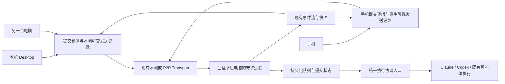
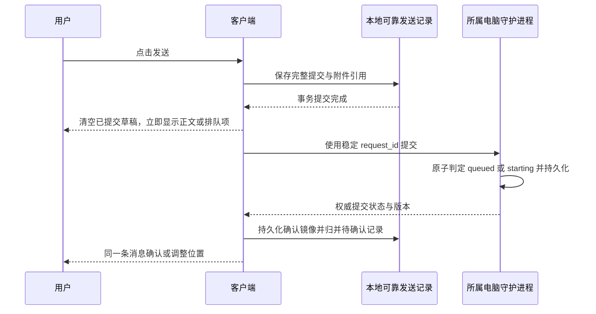

# 本地会话乐观提交与队列持久化方案

日期：2026-11-05。状态：协议、执行端、桌面和手机实现已落地；真实设备验收单独记录。设计基线为 `88b832066`，实现从远端 main 的 `e196293d` 隔离工作树开展。

目标：点击发送后立即获得反馈，发送内容经重启仍可恢复；会话所属电脑的守护进程统一决定执行顺序，本机、P2P 电脑和手机使用相同的提交语义。

## 1. 已确认的产品行为

1. 客户端判断会话空闲时，自己的消息直接出现在正文，不先显示排队，不等待网络确认后才展示。
2. 客户端已知有前台运行、较早的排队消息或尚未确认的提交时，新消息先显示在排队区。
3. 守护进程决定实际开始还是排队。客户端预测不一致时调整同一条消息的展示，不重新提交，不重复生成消息。
4. 清空输入框前，发送内容必须已经可靠保存到发起设备。等待本地存储提交完成，不等待远端确认。
5. 队列内容、顺序、附件引用、执行设置在正常退出、进程被杀和再次打开后可恢复。持久化失败时保留输入内容。
6. 重启界面不停止守护进程中的队列；守护进程重启后恢复内容并沿用当前暂停策略，由用户恢复执行。
7. 连接已明确不可用时，沿用现有禁止发送、保留草稿的行为；本方案处理发送过程中的断线，不新增离线定时发送功能。
8. 保持输入框复用、首条消息不闪烁、已有排队面板、停止和立即发送交互。模型处理计时以实际执行状态为准。

范围包括 Desktop 本机会话、Desktop 访问另一台电脑的会话，以及手机访问电脑的会话。文中的客户端也包括现有对话 GUI 的浏览器渲染层；不新增浏览器访问本地设备的入口，不改云端普通聊天协议。

## 2. 代码现状与设计依据

| 证据 | 当前实现 | 结论与对应设计 |
| --- | --- | --- |
| E1：[PromptService](../../packages/conversation-client/services/prompt-service.ts)、[prompt-runtime](../../packages/tutti-agent-gui-host/src/runtime/prompt-runtime.ts) | 已根据本地状态选择正文占位或排队；`visibleInQueue` 同时参与待发送状态推导 | 保留即时反馈，改用明确业务状态推导展示，见第 4、5 节 |
| E2：[桌面待确认存储](../../packages/tutti-agent-gui-host/src/runtime/desktop-pending-store.ts)、[runtime 接入](../../packages/tutti-agent-gui-host/src/runtime/create-multica-agent-gui-runtime.ts) | 待确认提交使用 `sessionStorage`；存储失败后仍可继续内存提交，且没有供调用者等待落盘的异步契约 | 补独立可靠发送记录，保存失败不能清空输入框，见第 6 节 |
| E3：[队列存储](../../server/internal/localconversation/store/queue.go)、[队列服务](../../server/internal/localconversation/service/queue.go) | SQLite 保存队列；派发标记属于内存；移除标记保留 7 天 | 在已有队列、回执上补持久化生命周期和执行占用；长时间离线不能把查无记录理解为可以重发，见第 7、9 节 |
| E4：[轮次记录](../../server/internal/localconversation/service/recorder.go) | 用户消息、轮次开始和请求回执已可在同一批次提交 | 扩展同一提交边界完成队列到正文的交接，见第 7 节 |
| E5：[桌面快照存储](../../apps/desktop/src/renderer/src/platform/local-v2-snapshot-store.ts)、[客户端管理器](../../packages/conversation-client/services/conversation-service-manager.ts) | 远端快照存 IndexedDB，最多 40 份，允许写失败；本机不使用该快照缓存 | 正文快照可继续淘汰；非终态队列镜像和待确认提交不能按正文 LRU 淘汰，见第 6 节 |
| E6：[手机草稿](../../apps/mobile/data/ai-sessions/drafts.ts)、[手机提交](../../apps/mobile/data/ai-sessions/submission.ts) | 已持久化草稿和每个会话的一条待确认提交；按本地判断选择 `send` 或 `queue_enqueue`，没有发送前可等待的可靠存储确认接口 | 手机保留独立实现，接入同一协议和可确认写入的原生存储，见第 6、11 节 |
| E7：[手机快照](../../apps/mobile/data/ai-sessions/snapshot-store.ts)、[原生文件缓存](../../apps/mobile/modules/multica-device-link/ios/DeviceContentStore.swift) | 正文快照延迟写入，运行中的快照不写，原生缓存最多 40 份 | 不把正文快照当可靠发送记录；队列状态需独立及时保存，见第 6 节 |
| E8：[协议 schema](../../packages/core/local-conversation/v2.ts)、[服务端 schema 目录](../../server/internal/localconversation/protocol/schema)、[会话同步服务](../../packages/conversation-client/services/conversation-service.ts) | 已有能力声明、存储代次、事件序号、队列版本和断线补快照 | 扩展现有协议，不建立第二条实时连接，见第 8 节 |

已合入的 #140 是提前检查会话忙状态和前端保守展示的修复，尚未提供本方案的原子执行占用、可靠客户端发送记录与结构化提交协议。

现状可通过 `git show 88b832066:<上述仓库相对路径>` 复核。以上是代码观察；下文是拟实施设计，不代表现有接口已支持。

## 3. 状态归属与模块边界



会话所属电脑是唯一执行权威；请求发起设备只保存自己的未确认意图和最后读取的状态。中继收到数据不能作为提交成功的依据，成功确认必须来自所属电脑完成持久化后的结果。

- Go 服务负责校验、去重、顺序、执行占用、生命周期和恢复。
- `packages/core/local-conversation/` 负责平台无关协议和纯校验规则，不访问平台存储。
- `packages/conversation-client/` 继续负责 Web/Desktop 的命令与事件投影，不依赖界面挂载。
- GUI runtime 连接领域状态和已有界面，不维护第二套权威队列。
- Desktop/浏览器平台适配器负责 IndexedDB；手机在 `apps/mobile/` 内维护独立状态与原生存储。手机只共享类型、schema 和纯函数，不导入 Web/Desktop Service 或 store。
- 继续复用现有按序号更新的会话模型；不新增一份 Zustand 服务端状态副本，也不为方案统一改造其他普通 API 数据层。

设备身份使用稳定设备 ID。存储和去重上下文至少包含服务端来源、账号、工作区、目标设备和会话，不使用设备显示名、端口或 tab ID 作为业务身份。

## 4. 明确提交、执行和本地确认状态

### 4.1 身份与关联

| 字段 | 规则 |
| --- | --- |
| `request_id` | 一次用户提交的稳定 ID，沿用当前请求身份；网络重试、重启恢复不改变 |
| `attempt_id` | 一次真正的执行尝试；明确重试执行时新建，并关联原提交 |
| `turn_ids` | 本次尝试关联的轮次；本地 Claude/Codex 通常一条，已有多智能体收件人场景可多条 |
| `message_id` | 正式用户消息身份；正文占位以 `request_id` 作为稳定展示身份，收到正式消息后合并 |
| `operation_id` | 暂停、移除、立即发送、重试等命令的去重身份，区别于消息提交身份 |

不能假设所有提交与轮次都是一对一。已有多收件人执行保持原并行能力，执行占用关联整个前台尝试，直到相应前台轮次结束或按既有策略终止。

### 4.2 三种状态各管一件事

| 层次 | 状态 | 含义 |
| --- | --- | --- |
| 客户端确认 | `saving`、`unconfirmed`、`confirmed`、`local_failed` | 本地是否落盘、执行端是否确认保存；不代表模型是否运行 |
| 执行端提交 | `queued`、`starting`、`attached`、`removed`、`recovery_required` | 等待、已占用执行位置、已交接正式轮次、已移除、执行交付需要恢复判断 |
| 执行尝试与轮次 | 准备、运行、等待回答、完成、失败、取消及交付未知 | 复用轮次的运行结果；准备与恢复信息归执行尝试，不把同一份终态复制到多个 store |

`queued` 可以附带阻塞原因，如队列暂停、等待恢复或上次准备失败。准备失败且确认未交付模型时，原提交返回带错误原因的队列，保留失败尝试；不会因此生成第二条用户提交，也不无条件自动重试。

`attached` 表示提交已经由正式轮次接管，不承诺模型已生成首个输出。是否运行、完成或失败从关联轮次派生。向外发送结果未知时保留原尝试，进入恢复判断，不能直接创建下一次尝试。

### 4.3 必须成立的不变量

1. 一个会话同一时刻只有一个前台执行占用；已有后台任务按原有边界管理。
2. 同一个 `request_id` 和相同执行内容重复提交，返回已有结果。不同内容复用 ID，返回当前 `request_conflict`。
3. 旧请求重试不能把 `removed` 恢复成 `queued`，也不能重放已关联的执行。
4. 一个提交在当前界面只有一份有效展示：正文占位、排队项或正式消息之一。
5. `visibleInQueue` 是展示推导结果，不能反推是否已交付模型。
6. 消息内容、引用、收件人和用户明确指定的设置在提交后不可被网络重试改变。编辑后重新发送属于新的提交。
7. 相同内容并不代表相同提交；去重依据身份和作用域，不按文本去重。
8. 客户端时钟只用于辅助展示，不决定跨设备顺序或状态新旧。

## 5. 保持即时反馈，并能原位纠正

### 5.1 本地预测

发送前读取客户端已提交的最新状态。满足以下条件时预测直接发送：没有前台执行、没有更早的排队项或待确认提交、队列未暂停、会话和运行时可用，且没有必须先回答的交互。

预测只决定展示位置。所有普通提交都进入统一的执行端准入流程，不拆成客户端自主选择的两条执行路径，也不先额外查询一次空闲状态。



本地写入期间保留草稿和提交内容；阻止同一份提交被重复点击创建。用户已经开始的新草稿不被晚到确认清空。内容和附件落盘前进程被终止，应由原有草稿恢复；发送记录提交完成后，由可靠发送记录恢复。

新会话首条消息同样先保存：沿用现有客户端生成的会话 ID，连同创建请求身份、执行目标、目录和初始提交一起持久化。先幂等确认会话创建，再准入首条消息；创建后确认包丢失时读取原会话 ID 核验，不新建替代会话。原有欢迎页到正文的输入框复用保持不变。

### 5.2 展示纠正矩阵

| 本地展示 | 权威结果 | 处理 |
| --- | --- | --- |
| 正文占位 | `starting` | 原位确认身份，不经过排队区 |
| 正文占位 | `queued` | 同一提交归入排队区，保留内容和顺序，不重发 |
| 排队项 | `starting` | 转入正文占位，等待正式轮次数据，不短暂显示两份 |
| 任一待确认展示 | 正式消息先到 | 按 `request_id` 直接合并，晚到回执不得回退状态 |
| 任一待确认展示 | 超时或断线 | 保留内容，显示待确认；不把连接异常当成模型失败 |
| 任一待确认展示 | 明确拒绝 | 保留可编辑内容和错误，支持明确重试；不覆盖新草稿 |

气泡可以立即显示，AI 运行计时和输出必须来自执行端状态。预测空闲不提前制造一个“模型正在运行”的正式轮次。

服务端空闲时，提交请求在本地短事务内确定 `starting`；不能因为内部先保存了队列就向客户端暴露必经的 `queued` 中间态。忙时才明确返回 `queued`。两种结果都不等待模型启动或输出。

保持一个以提交身份索引的展示实体，再选择其位置；不能指望不同父组件下相同 React key 自动保留 DOM。输入框独立于该位置切换，保持实例复用。流式正文不因提交确认而整体重建。

## 6. 为重启恢复建立可靠存储

### 6.1 三份数据的职责

| 数据 | 权威性 | 保存与清理 |
| --- | --- | --- |
| 发起端可靠发送记录 Outbox | 客户端拥有的未确认提交意图 | 清空输入框前提交成功；未确认记录不能因容量 LRU、正文切换或普通重启而删除 |
| 守护进程队列与提交记录 | 执行权威 | 使用现有 SQLite 写入链路，先提交再确认；终态记录负责恢复去重 |
| 客户端最小提交镜像 | 最后读取的权威状态，只用于展示和对账 | 保存未终结队列及执行关联；确认落盘后可取代对应 Outbox；不能当作新提交重放 |

正文快照继续使用现有可淘汰缓存。最小提交镜像独立于正文 LRU；不能因为 40 份正文快照被淘汰，让离线恢复时的队列展示一起消失。

Outbox 至少保存：schema 版本、完整作用域、请求 ID、本地提交序号、原始内容、执行内容、展示摘要、引用、收件人、附件持久化引用、明确的模型/推理/权限覆盖、首次创建时间及最后确认信息。不要写入认证 token、临时文件 URL 或只有内存能访问的对象。

未确认连续提交按同一发起设备的本地序号顺序准入，避免先点的消息因上传或网络完成顺序不同而排到后面。其他设备的提交以执行端持久化接收顺序为准，不用设备时间戳重排。

同一发起设备上的多个 tab 或窗口在持久化事务中分配序号，按完整作用域协调发送任务。多个窗口重复接管同一条记录仍使用原请求 ID，由执行端去重；不能各自生成替代 ID。请求和异步回写始终绑定发起时的固定作用域，不从晚到回调中的“当前工作区”重新取值。

### 6.2 平台实现建议

- Desktop/现有浏览器渲染层：使用独立的 IndexedDB 可靠记录存储，区分 Outbox、最小提交镜像和附件对象；不复用吞掉异常的正文快照写接口。确认点是事务 `complete`，不是单个请求的 `onsuccess`。
- 手机：在现有原生设备模块增加独立文件目录和可等待写入完成的接口，复用原生文件能力；每条记录原子替换，读取时校验 schema 和作用域。该目录不能使用会按 40 份淘汰的 `DeviceContentStore` 正文目录。
- 手机既有草稿与 SecureStore 偏好不整体迁移；本方案只迁移未确认提交与其必要附件。Web/Desktop 和手机各自实现平台存储，遵守相同可确认写入的契约。
- 大文件保持平台已有传输限制。附件选入后需保存持久化副本或可验证的已上传引用；如果原文件只存在于临时目录，不能声称重启可恢复。进程被杀后可以重试未完成上传，但不能提交缺少附件的正文。

平台持久化接口必须明确区分成功和失败。容量满、事务中止或文件不可写时不清空原内容；未确认记录不能以静默淘汰解决容量不足。

### 6.3 完成所有权交接

收到执行端持久化确认后，先写最小提交镜像，再移除对应 Outbox。IndexedDB 中放在同一事务；原生文件存储采用先写确认镜像、后删 Outbox 的顺序。允许短暂重复保存，启动时按请求 ID 合并；不能出现两边都没有内容的窗口。

若镜像写失败，Outbox 继续保留；内存仍可按权威状态展示。重启后重新对账，不自动重放已确认提交。

最小镜像只需保存足以重建队列和待执行消息的内容，不持久化每个流式 token。生命周期变化及时提交，不沿用正文快照的一秒防抖。

### 6.4 清理与隔离

关闭 tab、退出应用、切换工作区不删除未确认内容。退出登录停止同步，并清理可重读的会话快照；未确认内容按原账号隔离保留，再次登录同账号并核验作用域后才可恢复，不能被另一个账号看到或发送。

用户明确移除提交或清除此设备的数据时才删除相应本地意图。工作区权限被撤销、会话被删除或目标设备被移除时，停止发送并保留可恢复内容，不静默转投其他会话、账号或电脑。

普通存储成功表示在所用平台存储保证内可跨进程恢复，不承诺在用户清除应用数据、卸载、系统清理站点存储或存储损坏后仍然找回内容。

## 7. 统一准入与原子执行占用

### 7.1 所有前台入口经过同一协调逻辑

普通提交、队列出队、立即发送，以及仍然被旧客户端调用的直接发送，共用会话执行协调入口。保留各操作现有的行为：旧直接发送遇忙仍返回 `turn_running`，新普通提交遇忙进入队列；两者不能分别占用同一前台执行位置。

协调入口沿用现有会话串行化和 SQLite writer，补持久化占用信息，不引入消息中间件或分布式锁服务。多个 P2P 发起端最终在同一台所属电脑上仲裁。

### 7.2 两次短提交完成交接

第一次提交取得执行资格：

1. 核验队列策略、当前前台执行占用、运行时和权限。
2. 原子选定提交并占用会话前台位置，创建执行尝试、分配正式轮次身份。
3. 保存最终执行参数，将提交变为 `starting`，记录有版本的状态事件。
4. 提交完成后再进行运行时准备、附件解析和模型调用。

准备成功后，扩展当前 `startBatch`：用户消息、轮次、请求回执、提交的 `attached` 状态、移除队列项及相应事件在同一 SQLite 提交边界完成。客户端在正式正文到达前，仍可用 `starting` 记录维持同一条占位。

等待模型、启动子进程和网络访问不放进数据库事务。前台占用跨这些耗时操作保持有效，并携带尝试身份；回调必须匹配当前占用身份，过期回调不能释放新尝试的占用。

### 7.3 设置与错误处理

提交中的明确设置覆盖保持不变。默认设置在取得执行资格时解析，并保存本次实际执行值；同一个提交的网络重试不能读取更新后的编辑器选择改变载荷。

模型、权限、推理强度在取得执行资格后应用。准备失败且确认未交付时，释放占用、保留失败尝试、将提交恢复到带阻塞原因的队列。结果可能已交付时进入 `recovery_required`，不能按普通失败直接重试。

停止和立即发送也必须能处理 `starting`：准备尚未向模型发送时可取消本次准备并释放占用；已经进入外部调用窗口则等待取消结果或恢复判定，不能因正式轮次正文尚未出现而视为空闲。

执行尝试记录需区分尚未发起外部调用、已记录发送意图、已确认交付和交付未知。数据库无法与外部模型调用形成同一个事务，不能用一次本地原子写入宣称外部执行恰好一次。

### 7.4 数据演进

在现有队列/回执上补提交生命周期和尝试关联，复用已有输入内容与顺序。拟新增或扩展的记录为：稳定提交身份与状态、执行尝试及参数、会话前台占用。一个提交的队列顺序只有一个权威来源。

不维护新旧两套可独立修改的队列。旧接口所需字段由同一状态投影；schema 迁移需要回填当前队列和已有回执关联。新记录之间由应用校验关系，不增加外键或级联操作。

## 8. 在现有传输上扩展提交协议

本节是拟议协议，实施时同步修改 Go schema、TypeScript zod、黄金样例和异常响应测试。客户端消费字段必须通过 schema 和 `parseWithFallback`。

### 8.1 能力声明与命令

新增能力 `submission-lifecycle-v1`。只有所属执行端明确声明支持时，新客户端才使用新命令。已有 API 来源、账号、工作区校验、P2P 设备授权和命令白名单继续生效。

复用现有 `POST /local/v2/sessions/{id}/commands`，新增 `type: "submit"`，载荷沿用当前排队项结构，不另写一套附件、引用和收件人转换。

以下是协议结构示例，不是可直接调用当前版本的请求：

```json
{
  "type": "submit",
  "item": {
    "requestId": "submission-example-1",
    "content": "请继续分析",
    "attachmentIds": [],
    "display": {
      "id": "submission-example-1",
      "clientSubmitId": "submission-example-1",
      "createdAtUnixMs": 0,
      "content": [{ "type": "text", "text": "请继续分析" }]
    }
  }
}
```

`item` 内的 camelCase 是已有协议，保持兼容；新响应字段使用 snake_case，进入 TS 后统一转换。服务端校验执行内容和权限，不信任展示字段来判定运行状态。

提交确认使用 `202`；表示执行端已经持久化接收，不能被解释为模型已接收。重复提交返回已有状态，不产生第二次执行。

新 `submit` 在队列已暂停时仅保存并返回 `queued`，不隐式解除暂停；恢复执行使用明确的恢复操作。旧 `queue_enqueue` 保持当前外部语义，不能通过修改旧命令的默认行为实现新规则。

### 8.2 权威提交视图

| 字段 | 含义 |
| --- | --- |
| `store_generation` | 所属执行端数据库代次，沿用现有含义 |
| `snapshot_seq` | 该读结果对应的事件高水位，不作为客户端已消费事件游标 |
| `queue_revision` | 当前权威队列版本，沿用现有顺序控制 |
| `submission.request_id` | 稳定提交身份 |
| `submission.revision` | 该提交每次变化递增，包括恢复排队；不能按枚举大小判断新旧 |
| `submission.state` | 第 4 节定义的生命周期 |
| `submission.position` | 排队中的相对位置，非排队时为空；跨设备以服务端顺序为准 |
| `submission.blocked_reason` | 暂停、准备失败等已知阻塞原因，可空；未知原因保守展示 |
| `submission.attempt` | 尝试 ID、关联轮次 ID 列表和恢复信息，可空 |
| `submission.message_id` | 正式消息已建立时返回，可空；用于合并占位 |

模型是否开始和执行结果优先读取已有轮次，避免复制一份易失真的终态。

沿用 `POST /sessions/{id}/queue/status`，在保留原 `statuses` 的基础上，为新能力增加结构化提交视图及版本。按当前上限分批查询，不能仅扫描最近几轮正文判断是否已发送。

### 8.3 事件和快照

复用现有会话事件流，新增 `submission.updated` 事件，包含完整提交视图及本次 queue revision。一个语义变化所需的提交、执行关联和展示信息在一个事件中给齐。

初始快照增加可选的结构化提交集合，至少覆盖当前排队、准备中和需要恢复判断的记录；已执行的待确认 ID 由状态查询补齐，不返回全部提交历史。

快照、状态查询和命令回执中的关联字段必须来自一致的已提交视图。使用同一读事务或等价的一致读取边界，避免组合出旧队列、新占用和另一个时刻的序号；不能仅给分别读取的字段附上一个最新序号就声称它们一致。

旧 `queue`、`queue.updated`、正式 `user.message` 和轮次事件保持原有兼容结构。新增状态不能改变旧 `turn.started`、`dispatching_request_id` 的含义；旧派发字段只作为旧界面投影，不再作为新界面的生命周期依据。

HTTP 回执、事件和快照由同一状态合并规则处理。较早回执不能覆盖较新事件；部分状态查询的高水位只用于请求补差，不能直接推进完整会话事件消费游标，否则会跳过未读取的正文事件。

## 9. 重启、断线和未知结果的恢复

### 9.1 客户端启动

1. 按当前账号、API 来源、工作区和目标设备读取 Outbox 与最小镜像；先恢复展示，不据此自动执行。
2. 建立原有连接，确认执行端身份、能力和存储代次。
3. 用未确认请求 ID 查询提交状态，并拉取权威队列/快照。
4. 在同一展示归并中关联排队项、准备占位和正式消息，再完成本地持久化交接。
5. 恢复本设备尚未交付的提交时，保持原请求 ID 和顺序。

### 9.2 对账结果

| 执行端结果 | 客户端行为 |
| --- | --- |
| 已排队 | 采用权威队列，不从本地镜像重新入队 |
| 已准备或关联正式轮次 | 关联尝试与正文，移除重复占位，不重发 |
| 已移除 | 清理对应本地待确认意图；晚到网络重试不能恢复它 |
| 明确未接收，且仍属于同一受信任存储历史 | 原 ID、原载荷重试准入 |
| 交付未知或执行端无法证明未接收 | 保留内容和待确认状态；不自动创建新尝试 |
| 数据库代次变化、设备替换或会话不存在 | 停止自动重试，保留内容；不能把旧提交静默发送进新数据库 |

新能力下，查询无记录必须说明该 ID 是否仍在可证明的去重历史范围内。已有 `none` 不能被扩展解释为永远安全重发；旧移除标记只有 7 天，长期离线尤其需要保守处理。

建议新提交身份记录在会话存续期间保留最小去重信息：身份、指纹、移除/关联结果和尝试关联。正文内容可按原有清理策略处理；不得仅因普通缓存 TTL 清除去重事实后，再接受同 ID 作为新提交。会话删除后不允许恢复旧提交创建新会话。

### 9.3 守护进程启动

普通排队项从 SQLite 恢复，沿用当前启动后暂停的行为。恢复中的前台占用先核对已有模型进程、原生会话和轮次信息，再决定继续关联、确认未交付或保留未知结果。

“占用超时”或“旧进程失联”不等于模型未接收，不能据此自动重发。可确认未交付的准备失败允许明确重试，创建新尝试并保留同一用户提交。多收件人部分已交付时，不能重新执行已经接收的收件人。

## 10. 暂停、移除与立即发送的竞争规则

| 操作 | 规则 |
| --- | --- |
| 移除 | 与取得执行资格在同一会话协调入口仲裁；仍排队则写入移除事实，已取得资格则沿用 `queue_item_started` 或转为明确停止操作 |
| 暂停队列 | 阻止后续取得资格；不伪造当前轮次已停止 |
| 停止当前执行 | 区分请求已接收和实际停止；执行位置直到停止结果确认后才释放 |
| 立即发送 | 保留现有调整优先级、请求停止上一轮和暂停队列单次发送语义；不能提前释放旧占用 |
| 重试准备失败 | 确认未交付后创建新尝试；原始执行载荷保持稳定 |
| 重试网络提交 | 原 ID 返回已有提交状态，不调用模型第二次 |

用户操作在原发设备和远端设备同时发生时，以执行端提交顺序和当前状态仲裁。操作回执丢失后使用相同 `operation_id` 重试；不能重复停止一个后续轮次，或让旧的恢复命令解除用户后来设置的暂停。

## 11. 代码落点与分阶段交付

### 11.1 修改范围

| 模块 | 拟修改职责 |
| --- | --- |
| `server/internal/localconversation/store/` | 提交/尝试/占用记录、队列交接与去重保留、迁移及崩溃恢复测试 |
| `server/internal/localconversation/service/` | 统一准入、资格占用、设置应用和操作仲裁；复用原有 runner |
| `server/internal/daemon/localhost/` 与协议 schema | 新能力、`submit`、结构化状态查询、快照及授权白名单 |
| `packages/core/local-conversation/` | 新协议 schema、类型、纯状态归并规则及错误响应测试 |
| `packages/conversation-client/` | 注入可靠存储接口、提交与恢复流程、稳定身份归并；收拢原有待确认列表，不长期维护两套 Outbox |
| `packages/tutti-agent-gui-host/src/runtime/` 与 GUI state | 使用统一提交状态推导排队/正文，保留现有输入框实例与行订阅范围 |
| `apps/desktop/src/renderer/src/platform/` | IndexedDB 可靠记录适配、启动恢复和退出登录隔离；原正文快照继续可淘汰 |
| `apps/mobile/data/ai-sessions/`、对应组件与原生设备模块 | 手机独立实现状态消费和原生持久化，复用协议，不引入桌面 store |

### 11.2 建议实施顺序

1. 固定协议和状态不变量，增加准入/恢复的失败测试与协议样例。
2. 实现执行端提交记录、统一准入和原子占用；旧入口也经过同一仲裁，先验证执行正确性。
3. 实现 Desktop 可靠存储、接收确认和启动对账，保存成功前不清空草稿；接入当前乐观展示。
4. 接入结构化事件与快照，替换临时派发字段的展示判断，验证首发和双向纠正不闪烁。
5. 接入手机独立持久化和新协议，完成 P2P/手机实机验收。
6. 通过能力和平台验证后启用新提交流程，旧接口保留外部兼容投影；删除已迁移的客户端内部重复状态。

每一步独立可验证。所有平台达到对应验收标准后才将整项能力记为完成，不把桌面单测通过写成手机已验证。

## 12. 兼容方案与发布边界

| 客户端 / 守护进程 | 行为 |
| --- | --- |
| 新客户端 / 新守护进程 | 使用新准入和结构化生命周期，按版本对账 |
| 新客户端 / 旧守护进程 | 使用原队列命令与状态查询，保留 #140 的展示保护；可靠本地记录仍生效，无法确认的结果不自动重放 |
| 旧客户端 / 新守护进程 | 旧接口和错误语义保留，由同一协调入口执行，返回旧字段投影 |
| 不支持某个新增状态的客户端 | 保留内容，降级为待确认或请求刷新；未知状态不能默认“未发送”或“可重试” |

这一兼容处理限定在外部协议边界。内部保持单一提交/队列真相，不用双写两个可独立执行的队列来兼容。

存储迁移先读取、校验旧记录，写入新可靠记录，确认事务完成后标记迁移成功。中断或写失败时保留原记录；`sessionStorage`、手机既有待确认记录只导入一次。原账号、目标设备和会话不可丢失，身份无法确认时保留原始记录并阻止自动发送。

旧记录中没有保存的模型选择、引用或附件字节无法通过迁移补造。缺失执行参数或附件时恢复可见内容并说明需补全，不用当前编辑器设置替换原意图，也不把不完整载荷自动发送。跨重启的完整内容保证适用于新存储确认成功的提交。

客户端回退可以关闭新能力使用；守护进程不能在仍有新格式准备占用时直接降级旧二进制。需停止接收新尝试，完成或确认恢复当前占用，验证等待队列可由目标版本读取后再降级。不在运行中的开发环境自动重启或执行降级演练。

## 13. 验收矩阵

| 编号 | 场景 | 必须观察到的结果 | 主要验证层 |
| --- | --- | --- | --- |
| A1 | 空闲会话发送 | 本地保存完成后立即出现正文；不等待网络；不必经可见排队 | 客户端组件、浏览器 E2E |
| A2 | 运行中发送 | 立即显示排队；下一条不改上一轮设置；完成后只执行一次 | Go 服务、运行时 |
| A3 | 客户端预测空闲，另一设备抢先开始 | 原占位归入队列；原 ID、原内容，不重发 | 可控 P2P 传输、组件 |
| A4 | 客户端预测忙，执行端已空闲 | 排队项转正文，不出现两份，输入框不重建 | 组件、浏览器 E2E |
| A5 | 连续快速发送三条 | 本设备顺序保持；后两条不同时预测为首条 | 客户端服务 |
| A6 | 附件上传完成顺序不同 | 原提交顺序保持，不发送缺失附件的正文 | 上传与准入测试 |
| A7 | 本地写入失败或磁盘满 | 输入内容保留；未声称保存成功；不丢附件引用 | 存储适配器、组件 |
| A8 | 保存成功、请求尚未送达时杀进程 | 重启恢复原内容和 ID，对账后按规则处理 | 独立进程恢复测试 |
| A9 | daemon 已保存、确认包丢失 | 重启能查回；不重复入队或执行 | Go 回执、故障传输 |
| A10 | HTTP 确认晚于运行事件 | 不回退到排队，事件消费游标不跳过正文 | 纯归并规则 |
| A11 | 正文快照被 LRU 淘汰 | 未确认记录和非终态队列镜像仍在 | 存储测试 |
| A12 | 队列状态变化时应用退出 | 恢复到已提交记录；未完成交接仍有 Outbox | 事务中断、进程测试 |
| A13 | 只重启界面 | 不暂停或重复发出 daemon 中的队列 | 独立假宿主 E2E |
| A14 | 重启 daemon | 内容、顺序和设置恢复，队列暂停等待恢复 | Go 启停测试 |
| A15 | 模型收到请求后 daemon 崩溃 | 能关联则恢复；不能确认则保留未知，不自动重发 | 假模型故障注入 |
| A16 | 两台电脑与手机同时发送 | 所属电脑唯一仲裁，前台执行不重叠 | Go 并发、实机设备互联 |
| A17 | 移除与出队同时发生 | 只出现一种权威结果，旧重试不能复活移除项 | Go 并发 |
| A18 | 立即发送与停止确认乱序 | 上一轮实际结束后目标才取得资格；旧命令不影响新轮次 | Go、客户端操作测试 |
| A19 | 手机退出重开，电脑离线 | 恢复内容与待确认状态，连接恢复后对账 | iOS 实机 |
| A20 | 账号、工作区或目标电脑切换 | 不读取、清除或发送其他作用域的记录 | 各平台存储、组件 |
| A21 | 旧客户端或旧 daemon 混用 | 保留现有接口；未知结果不会被自动重放 | 协议黄金样例、版本矩阵 |
| A22 | 长期离线超过旧移除标记保留期 | 不把 `none` 当可重发证明 | 恢复规则、Go 存储 |
| A23 | daemon 数据库重建或设备替换 | 保留原内容并阻止自动投递到新历史 | 代次恢复测试 |
| A24 | 同提交多智能体收件人部分执行 | 保持原并行语义，恢复不重复执行已接收的收件人 | Go 假远端执行 |
| A25 | 准备阶段失败 | 原提交可恢复，新尝试有独立身份，不显示两条用户消息 | Go、运行时 |
| A26 | 新会话首发在创建或提交间退出 | 恢复原会话 ID 和首条内容；不创建重复会话或首轮 | 创建流程、进程恢复 |

共享逻辑的状态矩阵只在纯函数或服务层做一份规范测试，组件主要验证接线与命名回归。默认测试使用假 Claude/Codex 和假设备传输，不调用已安装的真实模型 CLI。

体验证据记录点击、本地事务提交、占位首帧、daemon 接收/准入、状态归并和正文首帧时间。判断标准是占位不依赖网络往返、不增加一次状态预查询、正常路径没有队列闪现、异常路径没有内容消失或重复行。存储时延先测量再定优化目标，不通过延迟权威确认或跳过落盘来美化数据。

## 14. 验证命令与交付要求

以下命令覆盖实现的自动验证；原生与跨设备交互仍需单独验收。

```sh
pnpm --filter @multica/conversation-client test
pnpm --filter @multica/conversation-client typecheck
pnpm --filter @multica/conversation-client lint
pnpm --filter @multica/tutti-agent-gui-host test
pnpm --filter @multica/tutti-agent-gui-host typecheck
pnpm --filter @multica/desktop test
pnpm --filter @multica/desktop typecheck:web
pnpm --filter @multica/mobile typecheck
pnpm --filter @multica/mobile lint
pnpm --filter @multica/mobile test
node scripts/check-conversation-render-stability.mjs
(cd server && go test -race ./internal/localconversation/... ./internal/daemon/localhost -count=1)
git diff --check
```

浏览器布局、首发和恢复另用已有假宿主 E2E 扩展验证；P2P/手机的断线、退出重开和多端竞争需要单独记录实机结果。最终交付报告分别列出自动验证、真实设备验证及未覆盖场景。

实施期间保留当前本地 dev 和 daemon，不因准备方案或执行默认测试而重启。发布或加载新 daemon 的运行验证安排在可控隔离环境，不能把已合入代码写成当前运行进程已加载该能力。

## 15. 本次方案检查

- [x] 乐观展示与实际执行确认分离，覆盖预测纠正和连续提交。
- [x] 区分可靠发送记录、权威队列、非终态镜像及可淘汰正文缓存。
- [x] 规定落盘确认、所有权交接、附件恢复、长期离线和重复执行边界。
- [x] 本机、P2P 和手机共用协议，手机保持独立实现。
- [x] 列出根本改造、旧版本兼容、分阶段交付和验收条件。
- [x] 现状引用已核对；文档本地相对链接与空白检查通过后交付。

## 16. 实现与验证边界

- 执行端在 SQLite writer 事务中保存提交、尝试、执行占用及队列到正式消息的交接。旧直接发送入口共用占用；新 `submit` 通过 `submission-lifecycle-v1` 协商启用。
- 结构化状态查询只合并提交版本，不替换完整队列、不推进事件游标。已移除的身份长期保留；控制操作通过 `operation_id` 去重，并限定停止的目标轮次。
- 桌面使用独立 IndexedDB 保存发送记录和附件文件。存储事务完成后清空草稿，网络失败保留冻结参数和请求身份；已有临时记录完成迁移后清除。
- 手机使用 Application Support 下的原子文件保存队列记录，并保留发送附件的持久副本。手机独立维护展示与恢复逻辑，复用平台无关的协议 schema。
- 执行结果未知时保留执行占用和原始消息，要求用户明确重试或移除。多接收对象的轮次共同决定交付状态；任何一方结果未知都不能被另一方的正常完成覆盖。
- 自动测试覆盖并发准入、存储失败、原子交接回滚、重启恢复、跨本机/手机传输幂等、控制重试、过期停止目标、附件恢复和状态版本倒序。原生持久化代码另做 iOS SDK 类型检查。
- 自动测试使用假模型和隔离数据库，不运行用户安装的模型 CLI。手机真机的键盘、返回导航、进程杀死、真实 P2P 网络切换和磁盘掉电未据此宣称已验收。
- 当前运行的 dev 与 daemon 保持原状。合入代码不会令该进程自动加载新 daemon 协议；新协议运行验收应使用隔离实例或后续明确安排的更新窗口。

