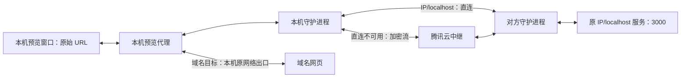

# 通过 P2P 预览远端本地服务

状态：V1 已实现并执行自动化验证；真实双设备的打包态验收仍待执行。设计基线为 `8081f0210`，外部资料核验于 2026-10-30。

目标：在远端会话里点击 `http://localhost:3000/login`，本机显示对方的页面，并支持图片、接口请求、WebSocket 和开发服务热更新。地址保留原义，设备身份使用 peer ID；公网 IP 由现有 P2P 层负责选择。

## 1. 方案选择与范围

推荐采用“设备隔离的浏览器会话 + 本机固定代理 + P2P TCP 流”。浏览器保留原始 URL，由代理把 IP / localhost 服务请求送到目标设备。复用已有设备发现、同账号设备认证、直连和中继机制。

| 方案 | 工作方式 | 适用范围与代价 |
| --- | --- | --- |
| 根本方案，推荐 | 每个远端设备上下文使用独立 Electron Session，浏览器请求经过固定代理，再按目标设备路由 | 保留 URL、Host、Origin、Cookie 和重定向语义；需要实现代理与浏览器生命周期管理 |
| 兼容方案 | 本机临时回环端口通过 P2P 映射到远端指定端口 | 可以用于简单服务或外部工具；原始地址、绝对地址跳转、跨端口请求和 Cookie 行为会变化，需要服务配合配置 base URL |
| 现有静态文件预览 | 经文件 API 读取远端 HTML，再放入受限 iframe | 继续保留；无法承担完整开发服务的接口请求和热更新 |

V1 支持 HTTP、HTTPS、WS、WSS 和 SSE，IP 字面量与 localhost 按来源会话设备连接，保留目标地址；域名网页从访问端本机出口加载，沿用系统 DNS 与代理策略。HTTPS 保持浏览器正常证书校验。

V1 的 IP 服务转发受设备共享及允许端口约束，不提供通用 VPN、UDP、WebRTC 媒体转发或跨账号分享。远端文件定位卡顿是独立问题，不用启动 HTTP 服务替代文件读取接口的修复。

## 2. 实施前的代码依据

| 证据 | 当前行为 | 对方案的影响 |
| --- | --- | --- |
| [device_link.go](../server/internal/daemon/device_link.go) | `/local/devices/{peer}/local/v2/` 经 `/multica/local-api/1` 转发到对端的 Multica API | 复用现有通道做控制请求，新增协议承载服务 TCP 数据 |
| [p2p/stream.go](../server/internal/daemon/p2p/stream.go) | P2P 流可作为 `net.Conn` 使用；仅中继可达时，直接在中继上开流，打洞在后台进行 | 复用同一套直连和中继路径，不新增中继基础设施 |
| [resource-web-preview.ts](../apps/desktop/src/main/resource-web-preview.ts) | 网页运行于无应用 preload 的沙盒 WebContentsView；当前分区只按 owner 隔离 | 保留浏览器沙盒，分区键增加设备身份 |
| [local-resource-preview.tsx](../apps/desktop/src/renderer/src/pages/local-resource-preview.tsx)、[side-workspace-control.ts](../apps/desktop/src/main/side-workspace-control.ts) | 明确拦截远端回环 URL | 仅在能力协商、授权与代理就绪后启用远端服务预览 |
| [device_link.go](../server/internal/daemon/device_link.go)、[relay.go](../server/internal/p2pserver/relay.go) | 文件 API 中继传输有 5 MiB 限制；中继节点本身未设置每条连接的数据量/时长上限，仍有并发限制 | 新流协议独立计量；不能把文件接口的单响应限制机械用于长连接，也不能无限占用连接 |

## 3. 流量路径



服务分支由对方守护进程连接原始 IP 或 localhost 服务，响应沿原流返回。浏览器 HTTP、CONNECT 和 WebSocket 均流式转发；V1 普通 HTTP 请求使用独立上游流，CONNECT/WS 保留长连接。多个 P2P 流在现有设备连接上复用，不为每张图片创建新的中继 circuit。

本机代理必须处理所有远端预览页面的网络请求，再分类路由。域名分支使用本机出口；系统代理/PAC 的解析交给未配置该预览代理的独立 egress Session，避免递归解析到自身。必须覆盖 DIRECT、HTTP CONNECT 和本机已使用的 SOCKS 代理；无法支持的系统代理配置应显式报错，不能悄悄换成远端出口。系统代理凭据留在访问端。

## 4. 明确地址属于哪台设备

应用层保存逻辑目标，以下为字段结构示例，示例 ID 不代表真实设备：

```json
{
  "version": 1,
  "deviceId": "peer-of-remote-mac",
  "conversationId": "conversation-on-remote-mac",
  "url": "http://localhost:3000/login?next=%2Fhome"
}
```

- 账号、API origin、工作区取自当前已验证的应用上下文；不能从网页提供的 URL 获取。
- `deviceId` 跟随来源会话和 Side 标签，不通过文件路径、标题或 URL 猜测。
- 本机会话的 IP / localhost 地址由本机连接；远端会话的这些地址必须绑定对应 peer。所有 IP（包括公网 IP）均按此规则处理，不通过 DNS 判断归属。
- 只持久化上述逻辑目标。代理端口、连接句柄和短期凭据不写入布局存储。
- 恢复旧标签时，从已存在的设备布局命名空间恢复身份；无法确认来源的标签要求重新选择设备，不能默认访问本机。
- 对方离线、能力不足或代理失败时返回明确错误，禁止回退到本机同名地址。

## 5. 控制协议：创建、续期和关闭服务会话

通过现有设备代理访问远端 `/local/v2`，请求保持现有身份认证及 scope 校验。服务提供端在新建会话时验证该 conversation 确实属于当前 scope。

在 `/hello` 的 `capabilities` 中增加 `remote-service-preview-v1`，同时检查 peer 是否支持数据协议。旧版本缺少能力或返回未知路由时，客户端展示“该设备版本不支持服务预览”，保留现有文件预览。

| 方法 | 对端路径 | 作用 |
| --- | --- | --- |
| POST | `/local/v2/preview/services` | 验证共享策略，为指定 IP / localhost 目标创建短期服务会话 |
| POST | `/local/v2/preview/services/{service_id}/renew` | 续期已有服务会话，不扩大主机或端口范围 |
| DELETE | `/local/v2/preview/services/{service_id}` | 幂等关闭会话，终止该会话下的所有流 |

创建请求的协议字段采用 snake_case；进入 TypeScript 应用层后转换为 camelCase：

```json
{
  "version": 1,
  "request_id": "create-preview-001",
  "conversation_id": "conversation-on-remote-mac",
  "target": { "host": "localhost", "port": 3000 }
}
```

成功响应结构示例：

```json
{
  "version": 1,
  "service_id": "service-001",
  "capability": "example-only-not-a-real-credential",
  "expires_at": "2026-10-30T09:30:00Z",
  "protocol": "/multica/preview-tcp/1"
}
```

实际 capability 使用至少 256 位随机值，仅在本机主进程/守护进程和目标设备之间流转。对端记录绑定调用 peer、API origin、账号、工作区、会话、规范化主机和端口；capability 本身不能授权其他 peer。

`request_id` 在调用 peer 与 scope 内去重：相同参数返回仍有效的创建结果；参数冲突返回 409；已过期结果返回 `service_expired`，调用方明确使用新 request ID 重建。请求严格校验，响应使用 zod 与 `parseWithFallback` 并兼容附加响应字段。

服务会话租期初始设为 30 分钟；只要存在打开的引用标签，主进程每 10 分钟续期。切换窗口、标签隐藏或失焦不停止续期。对端重启后旧会话失效，访问端在原共享策略仍允许时重新创建。

## 6. 数据协议：复用 P2P 连接传输 TCP

新协议 ID：`/multica/preview-tcp/1`。使用现有 `Service.Dial` / `Service.Listen`，与会话 API 协议分开注册和撤销。

每个流先交换长度前缀 JSON：4 字节大端长度，JSON UTF-8 最多 4096 字节。请求结构示例：

```json
{
  "version": 1,
  "service_id": "service-001",
  "connection_id": "connection-001",
  "capability": "example-only-not-a-real-credential"
}
```

对端从已认证的 P2P 连接获取调用 peer，并从服务会话记录取得实际主机和端口。数据握手不能指定新的目标地址。校验有效、目标 TCP 连接建立后才返回 `{"version":1,"ok":true}`；之后进入双向字节流转发。

失败响应结构：`{"version":1,"ok":false,"error":{"code":"target_unreachable","message":"The target service is not reachable","retryable":true}}`，随后关闭流。成功后的 TCP 错误通过流关闭/reset 表达，不能把 JSON 错误插入网页字节流。

对端读取握手头的期限初始设为 5 秒，随后连接目标服务的期限为 10 秒；访问端对 P2P 拨号、握手和目标建连合计设置 20 秒等待，超时取消整个操作。支持取消、背压、半关闭和两端错误联动。转发使用流式复制，不能把响应整段放进内存。长连接不设置普通页面请求总时限，受会话租约、共享策略和连接状态管理。

## 7. 本机代理与浏览器隔离

Electron 主进程创建代理上下文，绑定已校验的账号、工作区、设备和服务会话。代理只监听 `127.0.0.1` 的临时端口，使用每个上下文独立的短期代理认证；主进程只响应匹配该 Session、代理端口及 `isProxy` 的认证事件。网页不能取得 capability，也不能要求代理切换 peer。

### 主进程如何接入本机守护进程

Electron 不能直接调用 Go 的 `Service.Dial`。新增仅接受 Desktop 主进程凭据的本机 WebSocket 入口：`GET /local/preview/tunnel?device_id={peer}&service_id={service}`。它不属于可转发的 `/local/v2` 命名空间，不向其他设备或 renderer 凭据开放。

主进程使用已有 Node `ws` 依赖连接此入口，在头部携带本机 Desktop 认证、现有 scope，以及 `X-Multica-Preview-Capability`。短期 capability 不进入 URL。守护进程校验后，拨号目标 peer，完成第 6 节握手；只有对端服务连接成功后才完成本机 WebSocket 升级。

升级后，二进制 WebSocket 帧承载 TCP 字节；文本控制帧只允许 `{"type":"half_close"}`，表示发送方向结束，另一方向仍可读。协议错误关闭本机桥并 reset P2P 流。桥接必须传播背压、取消及半关闭，不能靠文本消息编码网页正文。

完整服务路径为：浏览器 → 主进程 HTTP 代理 → 本机 WebSocket 桥 → 本机 daemon → P2P 流 → 对端 daemon → 对端原地址 TCP。每个浏览器 TCP 隧道对应一个本机桥和一个 P2P 流；已有 HTTP keep-alive 与 WS 连接继续复用。主进程域名 egress 分支不经过该桥。

### 固定代理与站点数据

代理职责：

1. 解析浏览器 HTTP absolute-form 请求、CONNECT 请求和 WebSocket 握手，规范化 authority。
2. IP / localhost 目标查找当前上下文中相应主机/端口的授权服务会话，经新数据协议建立流；未授权的新端口返回 `port_not_allowed`。
3. HTTP 保留 Host、路径、查询参数和网页 Origin，按 HTTP 代理语义处理 hop-by-hop 头。CONNECT 成功前不能向浏览器返回 200；HTTPS/WSS 的 TLS 字节透传，不进行 TLS 解密。
4. WS Upgrade 后、SSE 响应中都持续流式转发；域名目标进入本机 egress 分支，不能误送远端。
5. 代理认证头在本机消费，不发送给网页服务。应用 token、设备互联 token 和 capability 不能混入网页请求。

分区键包含 `apiOrigin + userId + workspaceId + deviceId + conversationId`。增加会话维度，使不同会话的端口授权和浏览器状态一致隔离；同一来源会话的多个标签共享站点状态。本机预览和各远端设备分别隔离；不会自动复制本机浏览器登录态。服务会话与代理按引用计数管理，关闭最后一个关联标签时释放。退出账号或关闭设备共享时立即撤销并关闭已有连接。

首次 `loadURL` 前配置固定代理，并显式设置 `proxyBypassRules: "<-loopback>"`；不能使用 PAC 来决定是否代理 localhost。代理更换时关闭旧连接池，并等待新代理配置生效，再允许加载页面。配置中不提供 DIRECT 自动降级，否则远端失联时可能访问本机服务。

保留现有 sandbox、contextIsolation、webSecurity 和无应用 preload 的设置。继续执行正常证书验证、CORS 及浏览器网络权限校验；需要的浏览器网络权限仅对已绑定上下文、已授权端口和对应预览 WebContents 做精确判断，不能全局放行。

## 8. 地址、共享与跳转规则

| 地址类别 | V1 处理 |
| --- | --- |
| `localhost`、`*.localhost` | 对端固定使用回环地址连接，可尝试 IPv6/IPv4；原始 Host 仍保留，不经任意 DNS 解析 |
| IPv4 / IPv6 字面量（含私网、公网、链路本地与映射地址） | 对端连接原 IP，不改写为 localhost；目标主机与端口绑定服务会话，需允许该端口 |
| `0.0.0.0`、`::` | 同样保留原地址，是否可连接由目标设备网络栈决定 |
| 其余域名 | 访问端本机 egress；不因 DNS 返回 Fake-IP、私网或回环 IP 而改变归属 |

分类只看标准化后的 URL 主机，不用 DNS 推断是否为服务。域名分支遵循访问端系统网络策略：DIRECT 使用系统 DNS 返回的地址；HTTP CONNECT、SOCKS4a、SOCKS5 交给显式系统代理解析域名，不先解析再固定为目标 IP。这使代理 Fake-IP 与仅代理可解析的域名可用，也意味着域名的最终地址限制由系统网络策略承担，不再在此分支额外实施公网 IP 白名单。代理失败只尝试系统给出的后续路由，不自行增加 DIRECT。代理基础设施地址不会递归进入预览代理。

URL 标准化覆盖 IPv6、大小写、尾点及非标准 IPv4 写法；用户信息 URL 与不支持的协议拒绝执行。远端 IP / localhost 的外部浏览器入口禁用，避免打开访问端的同名服务。

设备现有“共享会话”开关不能自动授权任意本地端口。手动共享由独立服务预览开关与允许端口配置管理；Agent 按用户启动/预览服务的请求登记临时端口时，仅允许当前来源会话访问该回环主机和端口，不改永久配置。V1 沿用同账号设备边界，每次新流均检查共享状态、端口策略和租约。关闭共享立即中止已有转发。

相对路径、同端口跳转、Cookie 和同源接口由浏览器按原 URL 处理。跳转到其他 IP / localhost 端口必须先获得该端口的独立服务会话；授权完成后由用户重新导航，不自动重放 POST。跳转到域名进入本机 egress。自签名 HTTPS 不关闭全局证书验证；作为浏览器证书错误展示。

## 9. 断连、中继与故障恢复

- 新流复用现有 P2P 直连优先、中继兜底行为。中继升级为直连后，新流优先走直连；已建立的 TCP/WS 流不会自动无损迁移，不能为切换路径强行重置正在使用的流。
- 新协议不直接继承旧文件 API 的 5 MiB 单响应限制。初始限制建议为每个 peer/工作区最多 32 条转发流，并计量上传/下载字节数；中继并发仍受现有账号 circuit 限制。上线前通过资源管理器测试确认实际可用并发。
- 断网时已有页面可以保留显示，但转发标为已断开；恢复后重建会话和连接。WS/HMR 由网页客户端重连，HTTP 非幂等请求不自动重放。
- 旧设备返回能力不足时停止，不借用本机 localhost 或伪造成功。代理入口失败也不切换 DIRECT。
- 对端记录 peer、端口、直连/中继、结束状态、耗时和双向字节量；不记录 Cookie、capability、Authorization、请求正文或带敏感查询参数的完整 URL。

| 错误码 | 含义 | 恢复方式 |
| --- | --- | --- |
| `preview_unsupported` | 对方未实现 V1 协议 | 升级设备，保留静态文件预览 |
| `device_unreachable` | P2P 直连及中继当前不可达 | 展示断连状态，恢复后重新建连 |
| `service_sharing_disabled` | 对方未开放服务预览 | 对方启用独立服务共享策略 |
| `port_not_allowed` | 未授权目标主机/端口 | 对方手动配置端口或由当前会话 Agent 登记，再重试 |
| `target_unreachable` | 对方服务未启动或地址不匹配 | 对方启动服务，再重试 |
| `service_expired` | 服务会话过期或守护进程重启 | 策略允许时重新创建 |
| `preview_connection_limited` | 转发流或中继资源达到限制 | 等待已有流释放后重试 |
| `preview_proxy_unavailable` | 本机代理尚未就绪/已失效 | 重建代理；禁止本机直连降级 |

UI 区分“连接设备”“连接服务”“正在加载页面”“已断开”“访问被拒绝”，每个阶段有独立错误与可操作的重试入口，不再统一长时间显示“正在定位文件”。

## 10. 修改边界与实施顺序

1. **验证浏览器网络边界。** 用两个回环服务返回不同标识，先证明独立 Session、固定代理、回环绕过关闭、CONNECT/WS、浏览器网络权限及系统代理出口均符合预期。此阶段不接真实用户会话。
2. **实现服务协议和对端策略。** 在 Go daemon 增加控制路由、服务会话租约、新 P2P 协议、回环连接、流式转发和撤销。由 scope/peer 校验保护，同旧协议并存。
3. **接入本机代理与独立 Session。** 增加 Electron 主进程的上下文管理、代理认证、egress 适配和连接清理；在主进程本地客户端增加 WebSocket 隧道入口，在 daemon 注册仅主进程可用的本机桥。新共享 DTO 在 `apps/desktop/src/shared/`，跨端纯协议类型和 schema 放在 `packages/core/`，不把 Electron 状态放进 core。
4. **接入预览 UI 和 Agent。** `WebPreviewCommand` 增加明确设备来源；同步更新网页预览、来源会话传递、Side 标签恢复和 Agent 浏览器控制，只有新协议就绪才移除远端回环拦截。退出/隐藏/重启分别处理，隐藏不等于销毁。
5. **验证直连与腾讯云中继。** 先测试设备间直连，再强制仅中继；确认协议缺失、共享关闭、服务未启动和断线恢复均有明确结果，真实腾讯云链路和 macOS 打包态作为双设备验收项。

每一步单独可验证。第一步若发现所用 Electron 版本的代理/网络权限边界无法满足，重新评审根本方案，不静默采用 URL 替换绕过。

## 11. 验收场景

| 场景 | 必须观察到的结果 |
| --- | --- |
| 本机和两台远端都监听 3000，各自返回不同标识 | 每个预览始终显示目标设备的标识；断网也不会显示本机标识 |
| HTML 引用相对路径、绝对 localhost URL、图片和 fetch | 资源完整，Host/Origin 保持原义 |
| HTTP、HTTPS、WS、WSS、SSE | 正常通信；HTTPS 证书错误仍可见；SSE 不缓冲到结束才显示 |
| Vite 开发服务与文件修改 | HMR 通过对应远端端口生效 |
| 服务跳转到另一个未授权端口 | 明确阻止，不能自动扩大端口范围 |
| 同名 localhost 的 Cookie、Local Storage、Service Worker | 本机与不同设备之间不串用；同一设备恢复符合其分区策略 |
| 保留标签失焦、切换窗口及后台恢复 | 请求与订阅可以继续；不会因失焦释放会话或出现 inactive_host |
| 登录账号/工作区切换、关闭共享、关闭最后一个标签 | 对应连接和会话及时释放，旧凭据失效 |
| peer 直连、强制中继、网络切换 | 页面和流均可建立；断流后明确恢复，非幂等请求不重放 |
| 带大资源页面、并发资源、长时间 WS | 内存受背压约束，并发上限生效，中继字节量可观测 |
| 本机有系统 HTTP/SOCKS/PAC 代理，页面同时加载公网资源 | 域名走本机原出口，IP / localhost 走指定远端，不发生代理递归 |
| 旧 daemon、伪造 peer/capability、未共享 IP 端口 | 返回明确错误，不产生未授权连接 |
| 飞书域名 + Fake-IP / 代理解析 | 域名保持访问端出口；HTTP/SOCKS 使用域名目标，IP 不误送访问端 |

测试分层：Go 覆盖握手、策略、租约、撤销、半关闭和背压；主进程测试代理路由及 Session 隔离；组件测试来源设备与恢复状态；Electron/Playwright 集成测试实际 localhost 请求、WS 和系统代理；双设备测试直连和强制中继。CI 根据实际改动运行相关包的测试、类型检查及 lint。

## 12. 外部实现依据

- [Electron Session API](https://www.electronjs.org/docs/latest/api/session)：`setProxy` 和 `closeAllConnections`，代理配置必须在页面请求前生效。
- [Electron ProxyConfig](https://github.com/electron/electron/blob/main/docs/api/structures/proxy-config.md)：固定代理配置格式。
- [Chromium proxy documentation](https://github.com/chromium/chromium/blob/main/net/docs/proxy.md)：隐式回环绕过、`<-loopback>`、PAC 的限制、WebSocket 的代理选择及 CONNECT 语义。

## 13. 实现位置与验证

- `server/internal/daemon/servicepreview/`：策略落盘、作用域与 peer 绑定、30 分钟租约、控制 API、4 KiB 握手、原地址连接、32 流限制、撤销和字节统计。
- `server/internal/daemon/service_preview.go`：独立端口策略接口、仅 Desktop 主进程可用的本机 WebSocket 桥。
- `apps/desktop/src/main/preview-{proxy,tunnel,egress}.ts`、`remote-preview-network.ts`：代理认证、流式传输、系统出口、会话分区、引用计数与续期。
- `resource-web-preview.ts`、`local-resource-preview.tsx`、`local-side-workspace.tsx`、`side-workspace-control.ts`：页面和 Agent 控制携带来源设备与会话，恢复连接后加载，失败显示可重试原因。
- `service-preview-settings.tsx`：目标设备配置手动端口、显示 Agent 临时端口并撤销共享；扩大手动授权时明确确认。
- `server/internal/localconversation/service/preview_tools.go`、`servicepreview/agent.go`：Agent 内置登记工具、预览打开前自动登记、运行状态检查及临时授权清理。

使用方式：两端更新后，服务所在设备需开启“设置 → 本设备 → 设备互联”的设备互联总开关。

- **Agent 启动的服务**：继续由 Agent 的原生终端工具按现有权限启动。内置指令要求确认实际端口后调用 `service_preview_register`；`side_browser_open` 打开回环服务时也会自动登记。无需手填端口或修改永久共享列表。
- **已在终端启动的回环服务**：让 Agent 调用 `service_preview_register(port=3000)`；或在设置页手动开启服务共享、配置 `3000, 5173` 等端口。
- **IP 地址服务**：在来源设备手动共享对应端口，再打开如 `http://192.168.1.10:3000/` 的原地址；该设备直接连接此 IP，不替换为 localhost。Agent 自动登记仍限于回环服务。
- `service_preview_list` 只列出当前会话的登记；`service_preview_remove` 撤销当前会话的登记，不结束服务进程，不删除手动端口。所有写操作使用稳定 `request_id`。
- Agent 登记绑定账号/工作区 scope、来源会话、规范化主机和实际端口，不永久落盘，不自动打开设备互联总开关。最多 64 条登记；闲置 30 分钟后失效，打开预览的租约续期会延长其有效期。
- 每 5 秒检查端口监听状态；停服或失效后撤销登记及仅依赖它的连接。检测只确认 TCP 监听，不声称验证了进程身份。服务在同一端口立即被另一进程替换时，检测不能区分进程；手动策略同样按端口授权。
- 设置页显示“Agent 服务端口”，可停止全部临时共享。`DELETE /local/service-preview` 仅清空临时登记；关闭手动共享或设备互联会撤销临时登记。查询响应新增可选 `agent_ports` 数组，旧客户端可以忽略它。

在另一台设备打开该设备的来源会话，再打开其 `http://localhost:3000/` 链接。登记服务不会启动进程；启动命令仍遵守原生终端的权限与确认流程。

可复现检查：

```sh
pnpm --filter @multica/desktop test
pnpm --filter @multica/desktop typecheck
pnpm --filter @multica/desktop build
node scripts/check-remote-preview-proxy.mjs
cd server
GOTOOLCHAIN=go1.27.3 go test -race ./internal/daemon/servicepreview ./internal/localconversation/service ./internal/daemon/localhost ./internal/daemon/p2p ./internal/daemon
```

自动化覆盖真实 P2P 直连与强制中继、主进程桥权限、能力缺失、租约与撤销、HTTP/WS/SSE、6 MiB 流式数据、TCP 半关闭、设备 Cookie 隔离、后台保留、关闭清理、代理失败不访问本机、系统 HTTP/SOCKS 代理、Fake-IP 域名处理和 IP 原地址保留。Electron 检查在临时用户目录内执行，不使用真实账号或改变用户共享设置。

尚需人工验收：两台真实设备经部署的腾讯云中继运行 Vite HMR、HTTPS/WSS 可信证书页面、长时间休眠恢复和 macOS 打包态。系统代理要求认证时仍明确失败，不自动绕过系统策略。自签名 HTTPS 仍显示浏览器证书错误。Fake-IP 与代理端域名解析遵循上文域名出口规则。新增协议不要求修改现有中继部署。
